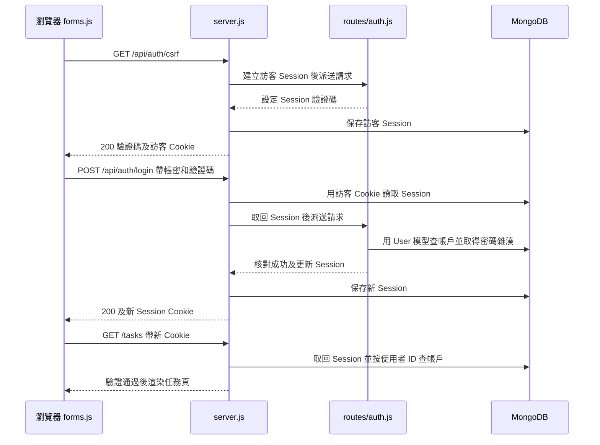

# 組員 1｜登入、登出、Session 及權限檢查

## 負責範圍

負責登入、登出及存取控制，包括登入表單、帳密核對、Cookie 和 Session，以及受保護頁面和 API 的登入檢查。組員 2 負責註冊及重設密碼，組員 6 負責 Cloud Run 的 HTTPS 及執行設定。 [帳戶流程](./member-02-registration-password-reset.md) · [Cloud Run 部署](./member-06-cloud-run-deployment.md)

## 程式碼地圖

| 檔案 | 在流程中的工作 |
| --- | --- |
| `views/login.ejs`、`views/partials/header.ejs` | 登入表單以 `data-auth="login"` 標記及指定 API 路徑。共用頁首載入 `forms.js`，並提供登入後使用的登出表單。[登入表單](../views/login.ejs#L6) · [共用頁首](../views/partials/header.ejs#L8) |
| `public/forms.js` | `initialize()` 判斷當前頁面，`handleForm()` 接管提交，`getCsrfToken()` 取得驗證碼，`request()` 處理 Cookie、JSON 和回應。[啟動](../public/forms.js#L308) · [表單](../public/forms.js#L65) · [請求](../public/forms.js#L27) |
| `server.js` | 設定 Session store 和 Passport 中介軟件，將網站頁面、任務 API 和帳戶 API 分派到各自的路由。[中介軟件與路由掛載](../server.js#L46) |
| `routes/auth.js`、`models/User.js` | 用 User 模型核對帳密和登入版本，管理 CSRF 驗證碼、登入及登出。[Passport 設定](../routes/auth.js#L29) · [驗證碼端點](../routes/auth.js#L76) · [登入及登出](../routes/auth.js#L114) · [帳戶欄位](../models/User.js#L4) |
| `routes/tasks.js`、`routes/api.js` | 頁面路由提供任務模板，API 用已登入的 `req.user.id` 找出該帳戶的任務。[頁面路由](../routes/tasks.js#L33) · [任務 API 查詢](../routes/api.js#L18) |

## 操作及請求流程



### 1. 伺服器先處理 Session，再選擇路由

Express 在靜態資源之後設定 `Cache-Control: no-store`，再依序執行 `express-session`、`passport.initialize()` 和 `passport.session()`。瀏覽器的 `taskflow.sid` Cookie 帶有使用 `SESSION_SECRET` 簽署的 Session ID。伺服器透過 `MongoStore` 用這個 ID 找回 Session 資料。`saveUninitialized: false` 讓新訪客 Session 在取得驗證碼等修改發生後才保存。`resave: false` 讓未修改的 Session 省去完整重寫。Cookie 設為 `HttpOnly`、`SameSite=Lax` 和兩小時有效期，`Secure` 由 `COOKIE_SECURE` 控制。 [中介軟件次序](../server.js#L43) · [Cookie 選項](../routes/auth.js#L9)

`GET /` 依登入狀態轉往 `/tasks` 或 `/login`。`guestPage()` 為訪客渲染登入、註冊或重設密碼頁，已登入的使用者開啟這些網址會轉往任務頁。`/dashboard` 通過頁面登入檢查後也轉往 `/tasks`。[頁面入口](../server.js#L65)

### 2. 瀏覽器組裝登入請求

1. `initialize()` 找到訪客表單時交給 `initializeGuestForm()`。該函式以 `FormData` 讀取欄位，將表單的 `action` 傳入 `request()`。共用的 `handleForm()` 取消原生提交、暫停提交按鈕避免重複請求，在 `finally` 恢復按鈕。[頁面初始化](../public/forms.js#L308) · [訪客表單](../public/forms.js#L82) · [提交處理](../public/forms.js#L65)
2. `request()` 發送 `POST` 前等待 `getCsrfToken()`。首次取得時呼叫 `GET /api/auth/csrf`，後端在訪客 Session 內以 `randomBytes(32)` 產生 64 位十六進位驗證碼，之後可沿用同一值。前端在目前頁面共用 `csrfRequest`，並把取得的值放進 `X-CSRF-Token`。帳密以 JSON 傳送，同源請求由瀏覽器帶上 Cookie。[前端請求](../public/forms.js#L25) · [CSRF 路由](../routes/auth.js#L76)
3. `POST /api/auth/login` 依序檢查 `application/json`、驗證碼和 JSON 請求體，大小上限為 16 KB。`requireCsrf()` 核對驗證碼格式，再用 `timingSafeEqual()` 和當前 Session 的值比較。登入路由去除使用者名稱首尾空格，確認名稱有 1 至 64 個字元，密碼為非空且最多 72 位元組的字串，然後交給 Passport Local strategy。策略透過 `User.findOne()` 明確選取 `passwordHash`，用 `bcrypt.compare()` 核對原始密碼輸入。[登入路由](../routes/auth.js#L114) · [請求驗證](../routes/auth.js#L56) · [使用者名稱規則](../routes/auth.js#L20) · [Passport Local strategy](../routes/auth.js#L29)
4. Passport 的 `req.logIn()` 建立新的 Session，`serializeUser()` 存入 `user.id`。登入路由再加入絕對到期時間、帳戶當前的 `authVersion`，以及新 CSRF 驗證碼，然後回傳 `200` 和新 Cookie。瀏覽器轉往 `/tasks`。新頁面的首次寫入會再次取得驗證碼，用新 Cookie 讀到已登入 Session 的值。[序列化](../routes/auth.js#L38) · [登入成功分支](../routes/auth.js#L122) · [前端導頁](../public/forms.js#L87)

### 3. Passport 恢復身分，路由再檢查操作範圍

`passport.session()` 把儲存在 Session 的使用者 ID 交給 `deserializeUser()`。程式先檢查 `authExpiresAt`，再以 `User.findById()` 取得帳戶，確認登入版本仍相同。舊帳戶或舊 Session 缺少版本時，`?? 0` 讓比較沿用初始版本。通過後 Passport 可設定 `req.user`，供 `req.isAuthenticated()` 和任務路由使用。[身分恢復](../routes/auth.js#L38)

```js
passport.deserializeUser(async (req, id, done) => {
  if (!(req.session.authExpiresAt > Date.now())) return done(null, false);
  try {
    const user = await User.findById(id);
    if (!user || (user.authVersion ?? 0) !== (req.session.authVersion ?? 0)) return done(null, false);
    return done(null, user);
  } catch (error) {
    return done(error);
  }
});
```

頁面使用 `requirePageLogin`。任務 API 依序驗證登入和 CSRF，再解析 JSON 及執行任務路由。`GET`、`HEAD` 和 `OPTIONS` 通過登入檢查後可略過 CSRF 比較。API 以 `req.user.id` 寫入或比對擁有者。單筆操作也比對網址的任務 ID，因此查詢不到該帳戶的任務時回傳 `404`。[路由掛載](../server.js#L79) · [登入及 CSRF 檢查](../routes/auth.js#L51) · [任務擁有者條件](../routes/api.js#L24)

```js
  app.use('/tasks', requirePageLogin, taskRoutes);
  app.use('/api/auth', auth.router);
  app.use('/api/tasks', auth.requireLogin, auth.requireCsrf, express.json({ limit: '16kb' }), apiRoutes);
```

### 4. 登出及返回頁面

在任務頁或任務表單頁，`initialize()` 顯示共用頁首的導覽，將登出表單交給 `handleForm()`。前端呼叫 `POST /api/auth/logout`，伺服器依次檢查登入和 CSRF，再執行 `req.logout()`、`req.session.destroy()` 和 `res.clearCookie()`。前端把無內容的 `204` 當作成功，`signOut()` 清除暫存提示並返回 `/login`。如瀏覽器從返回快取恢復頁面，`pageshow` 會觸發重載，讓伺服器重新檢查登入。[登出表單](../views/partials/header.ejs#L16) · [伺服器登出](../routes/auth.js#L135) · [前端登出及頁面恢復](../public/forms.js#L308) · [`signOut()`](../public/forms.js#L20)

## 逐步追蹤一次登入和登出

以下以自己的測試帳戶 `trace-demo` 為例。假設帳戶 ID 為 `507f1f77bcf86cd799439011`，登入版本為 `0`，上午 10 時登入。表中的「訪客」和「已登入」是 Session ID 的代稱，驗證碼 A、B 也是示意名稱。

### 每一個請求用了甚麼資料

| 請求或動作 | 瀏覽器帶入的資料 | 伺服器結果及下一步 |
| --- | --- | --- |
| 開啟登入頁 | 首次進入時尚無這個網站的 Cookie | `guestPage('login')` 渲染登入表單。`initialize()` 選取表單並綁定提交事件。[頁面入口](../server.js#L69) · [前端啟動](../public/forms.js#L308) |
| 第一次按 **Log in** | `getCsrfToken()` 先送出 `GET /api/auth/csrf` | 後端將驗證碼 A 寫入訪客 Session。回應包含 JSON `csrfToken` 和訪客 Session Cookie，頁面暫存取碼的 Promise。[取碼端點](../routes/auth.js#L76) · [頁面內快取](../public/forms.js#L25) |
| `POST /api/auth/login` | 訪客 Cookie、`X-CSRF-Token` 的 A、表單帳密 JSON | Session store 用訪客 ID 找回 A，路由先比對 A，再以使用者名稱查帳戶及核對密碼。成功後 Passport 保存帳戶 ID，路由把版本 `0`、中午 12 時的絕對到期時間、新驗證碼 B 寫入已登入 Session。回應 `200` 並更換 Cookie。[登入驗證及回應](../routes/auth.js#L114) · [Session 有效期](../routes/auth.js#L9) |
| `GET /tasks`，然後 `GET /api/tasks` | 瀏覽器在兩個請求自動帶上已登入 Cookie | 兩個請求各自由 Passport 恢復 `req.user`。頁面入口先回傳 HTML，之後 `loadTaskList()` 取得 JSON，API 以 `req.user.id` 限定任務清單。[頁面路由](../routes/tasks.js#L33) · [載入任務](../public/forms.js#L143) · [清單查詢](../routes/api.js#L18) |
| `POST /api/auth/logout` | 已登入 Cookie、從當前 Session 取得的驗證碼 B | 通過檢查後移除登入狀態和 Session，並指示瀏覽器清除 Cookie。前端收到 `204` 後轉到登入頁。[前端登出](../public/forms.js#L315) · [登出路由](../routes/auth.js#L135) |

### 三種資料各自的用途

- **Cookie 的 Session ID** 供 `express-session` 找到 MongoDB 的 Session 記錄。登入時更換 Session ID，讓訪客階段的識別碼與登入階段分開。Cookie 由瀏覽器管理，`HttpOnly` 保護它免被網頁指令碼讀取。[Session 設定](../server.js#L51) · [Cookie 屬性](../routes/auth.js#L9) · [登入成功分支](../routes/auth.js#L125)
- **帳戶 ID** 在 `serializeUser(user, done)` 時寫入 Session。後續請求由 `deserializeUser(req, id, done)` 重新查詢帳戶。API 用同一個帳戶 ID 作為資料擁有者，任務的 `_id` 則識別個別任務。[序列化及恢復](../routes/auth.js#L38) · [單筆任務查詢](../routes/api.js#L30)
- **到期時間、版本和驗證碼** 都屬於伺服器端 Session。後續頁面重新整理可延續該 Session 的登入。`authExpiresAt` 只在登入時設定，例子從中午 12 時起便不能恢復登入。版本比較也能讓重設密碼後的舊 Session 失效。驗證碼的用途是把寫入請求連到當前 Session，欄位值因登入而輪替。[檢查到期和版本](../routes/auth.js#L40) · [CSRF 比較](../routes/auth.js#L56) · [設定登入狀態](../routes/auth.js#L125)

### 參數、回呼與回應的交接

| 函式 | 收到甚麼 | 完成後交給哪一層 |
| --- | --- | --- |
| `handleForm(form, onSubmit, onError)` | 表單及兩個回呼 | 以同一個表單的 `dataset.submitting` 管理提交。執行 `onSubmit()` 時拋出的錯誤交給 `onError(error)`，最後恢復按鈕。[共用提交處理](../public/forms.js#L65) |
| `request(url, { method, body, authenticated })` | 表單 `action` 或任務 API 路徑，加上方法等選項 | 有 `body` 時送出 JSON。成功後交回解析後的 JSON。`204` 直接交回 `true`。預期已登入的請求若收到 `401`，先導回登入頁，再結束該次前端處理。[共用請求](../public/forms.js#L41) |
| Local strategy 的 `(username, password, done)` | 路由整理過的名稱及原始密碼 | 密碼相符時交回 `done(null, user)`。找不到帳戶或密碼不符時交回 `done(null, false)`。查詢或比對發生例外時交回 `done(error)`。[帳密策略](../routes/auth.js#L29) · [路由整理名稱](../routes/auth.js#L114) |
| `passport.authenticate('local', callback)` | Express 的 `req`、`res`、`next`，及策略交付的結果 | 先處理例外，交給 `next(error)`。驗證不通過時回傳 `401`。收到帳戶時才呼叫 `req.logIn(user, callback)`。[登入回呼](../routes/auth.js#L122) |
| `req.logIn(user, callback)` | 驗證通過的帳戶 | 成功回呼才追加到期時間、版本及新驗證碼，再回傳 `200`。若收到 `loginError`，交給 Express 的錯誤處理。[寫入登入狀態](../routes/auth.js#L125) |

下列片段中，`user.authVersion` 來自帳戶文件，`req.session.authVersion` 則是登入這一刻的副本。若 `req.logIn()` 的回呼帶有錯誤，第一個 `return` 會結束回呼，成功回應便只會出現在後續欄位設定完成的分支。[登入成功分支](../routes/auth.js#L125) · [集中錯誤回應](../server.js#L83)

```js
    req.logIn(user, (loginError) => {
      if (loginError) return next(loginError);
      req.session.authExpiresAt = Date.now() + sessionLifetime;
      req.session.authVersion = user.authVersion ?? 0;
      req.session.csrfToken = randomBytes(32).toString('hex');
      return res.status(200).json({ message: 'Signed in.' });
    });
```

### 登出回應如何回到畫面

1. 後端取得已通過登入和 CSRF 驗證的請求後，等 `req.logout()` 的回呼成功才呼叫 `req.session.destroy()`。任何一個回呼收到例外都交給 `next()`。銷毀成功後，`clearCookie()` 使用建立 Session 時同一組 Cookie 選項，再以 `end()` 結束 `204` 回應。[登出回呼](../routes/auth.js#L135) · [Cookie 設定](../server.js#L51)
2. 前端登出處理等待 `request()` 的回傳值。`request()` 在讀取 JSON 前就將 `204` 轉為 `true`，讓登出回呼可執行 `signOut()`。`signOut()` 移除 `sessionStorage` 的提示訊息，再用 `location.replace()` 導回登入頁。[回應分支](../public/forms.js#L49) · [登出回呼](../public/forms.js#L317) · [前端導頁](../public/forms.js#L20)

## 失敗時會發生甚麼

| 情況 | 結果 |
| --- | --- |
| 輸入錯誤帳密，或登入欄位格式不合規 | 登入 API 回傳 `401`。登入表單以 `authenticated: false` 呼叫 `request()`，錯誤會交給表單顯示。[登入回應](../routes/auth.js#L114) · [訪客表單錯誤](../public/forms.js#L82) |
| 瀏覽器缺少有效 Session、Session 已到期，或登入版本已更新 | 網頁任務入口轉到 `/login`，任務 API 回傳 `401`。在已登入的頁面，`request()` 收到 `401` 也會執行 `signOut()`。[身分恢復](../routes/auth.js#L40) · [頁面檢查](../server.js#L65) · [前端處理](../public/forms.js#L49) |
| 取得驗證碼時失敗，或提交時收到 `403` | 前端清空快取的 `csrfRequest` 並顯示該次錯誤，下次提交會重新取碼。一般 JSON 錯誤的 `error` 和 `fields` 由 `request()` 交給呼叫端顯示提示。[取碼失敗的處理](../public/forms.js#L27) · [處理回應及錯誤](../public/forms.js#L49) |
| 登入的內容類型錯誤，或 JSON 無法解析 | 登入的內容類型須為 `application/json`，否則回傳 `415`。JSON 格式錯誤或超過限制分別回傳 `400` 或 `413`。[內容類型檢查](../routes/auth.js#L67) · [Express 錯誤處理](../server.js#L84) |
| 查詢帳戶、建立登入狀態或銷毀 Session 時發生例外 | 錯誤傳到 Express 的集中處理。API 一般回傳 `500`，頁面則渲染錯誤模板。[Passport 錯誤分支](../routes/auth.js#L29) · [登出錯誤分支](../routes/auth.js#L135) · [錯誤回應](../server.js#L83) |

## 示範與口頭講解

按本機啟動指引啟動網站，並準備自己註冊的測試帳戶。 [本機啟動指引](./setup.md)

1. 在未登入的無痕視窗開啟 `/tasks`，畫面會轉到 `/login`。直接開啟 `/api/tasks`，會看到 `401` 及 `Please sign in first.`
2. 開啟開發者工具的 Network 面板並保留記錄。用自己建立的測試帳戶先輸入錯誤密碼，再輸入正確密碼。觀察登入端點先回傳 `401`，成功時回傳 `200`，重新整理任務頁後仍可查看任務。
3. 按 **Log out**。觀察已登入頁面首次寫入前取得驗證碼，以及登出回傳 `204`。再次開啟 `/tasks`，確認回到登入頁。[cURL 示範中的 Cookie 和驗證碼流程](../README.zh-Hant.md#curl-示範)

> 登入表單由 `forms.js` 接管，先取訪客 Session 的 CSRF 驗證碼，再向登入路由送出帳密。Passport 查找帳戶和核對密碼，登入後發出新的 Session Cookie 並更換驗證碼。之後 `server.js` 會先讀取 Session，讓 Passport 檢查有效期和登入版本，再交給頁面或 API。API 還會用帳戶 ID 選取私人任務。登出會銷毀 Session 及清除 Cookie。

### 演練提問及檢查位置

| 問題或觀察 | 講解時可指出的程式或證據 |
| --- | --- |
| 登入失敗後，為甚麼可以直接再試一次？ | `handleForm()` 在 `finally` 清除提交標記和恢復按鈕。帳密錯誤的 `401` 由訪客表單的 `onError` 顯示。訪客 Session 仍可用時，下一次提交沿用頁面已取得的驗證碼。[表單回呼](../public/forms.js#L65) · [訪客錯誤顯示](../public/forms.js#L82) |
| 登入後為甚麼要重新取驗證碼？ | 登入回呼在新 Session 生成新值。比較 Network 中的請求次序即可見訪客第一次取碼在登入前，新的取碼在登入後第一次寫入前。[登入時更新驗證碼](../routes/auth.js#L125) · [共用寫入請求](../public/forms.js#L41) |
| `POST /api/auth/login` 顯示 `200`，為甚麼還要檢查 `GET /tasks`？ | `200` 表明當次帳密驗證和登入回呼成功。`GET /tasks` 檢查瀏覽器有帶新 Cookie，伺服器也能從 store 恢復身分。Network 可依次核對回應狀態、Cookie 是否已更換，以及下一個請求有否帶上 Cookie。[Session 中介軟件](../server.js#L51) · [頁面保護](../server.js#L65) |
| `401` 和 `404` 各由哪一層回應？ | 受保護 API 的 `401` 由 `requireLogin()` 回應。指定任務的 `404` 可由 `Task.findOne()` 找不到同時符合任務 ID 和擁有者 ID 的文件而觸發。 [登入檢查](../routes/auth.js#L51) · [單筆任務路由](../routes/api.js#L30) · [組員 4 的 cURL 示範](./member-04-task-write-curl.md) |
| 前端按登出後沒有導頁，應從哪裏開始看？ | 先在 Network 看取碼及登出有否送出。登出收到 `403` 時，前端會清除取碼快取並顯示錯誤。收到 `204` 時，檢查 `request()` 是否走到 `return true`，以及登出回呼是否呼叫 `signOut()`。[回應分支](../public/forms.js#L49) · [登出回呼](../public/forms.js#L317) |
