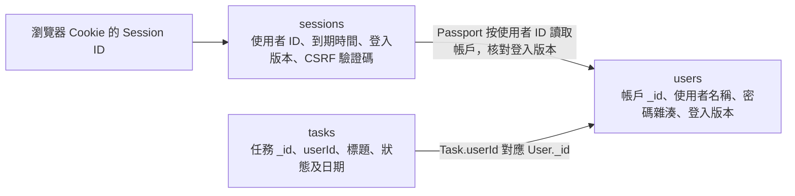

# 組員 2｜MongoDB、資料模型及帳戶管理

## 負責範圍

說明應用程式如何啟動並連接 MongoDB Atlas，帳戶、私人任務和 Session 如何關聯，以及註冊、重設密碼與重新登入時哪些資料會改變。

## 程式碼地圖

| 檔案 | 在流程中的工作 |
| --- | --- |
| `.env.example`、`compose.yaml` | 提供連線設定範本，Compose 將設定傳給容器中的程式。[環境變數範本](../.env.example#L1) · [傳入容器的設定](../compose.yaml#L7) |
| `server.js` | `start()` 驗證啟動設定，連接 Atlas，等候 User 索引就緒，並用同一 MongoDB client 建立 Session store。[啟動及連線](../server.js#L20) · [Session store](../server.js#L51) |
| `models/User.js`、`models/Task.js` | 定義 MongoDB 文件的欄位、預設值及索引。Task 模型用使用者 ID 記錄擁有者。[User 模型](../models/User.js#L4) · [Task 模型](../models/Task.js#L6) |
| `views/register.ejs`、`views/forgot-password.ejs`、`public/forms.js` | 表單收集帳戶資料，前端按表單的 `action` 送出 JSON 和 CSRF 驗證碼，顯示錯誤或返回登入頁。[註冊表單](../views/register.ejs#L5) · [重設密碼表單](../views/forgot-password.ejs#L5) · [提交與導頁](../public/forms.js#L82) |
| `routes/auth.js`、`routes/api.js` | 帳戶路由透過 User 模型讀寫資料。任務路由從 Passport 取得帳戶 ID，透過 Task 模型讀寫該帳戶的任務。[帳戶路由](../routes/auth.js#L81) · [任務路由](../routes/api.js#L18) |

## 操作及請求流程

### 1. 啟動時先準備資料庫

Compose 把 `MONGODB_URI`、`SESSION_SECRET`、`COOKIE_SECURE`、`TRUST_PROXY` 和容器內的 `PORT` 傳給 Node.js。`npm start` 執行 `server.js`。`start()` 先檢查資料庫連線設定、64 位十六進位 Session 密鑰和連接埠，再呼叫 `mongoose.connect()` 及 `await User.init()`。等使用者名稱的唯一索引就緒後，程式才會設定中介軟件和啟動監聽。[啟動指令](../package.json) · [Compose 的環境設定](../compose.yaml#L8) · [`start()` 的連線和索引檢查](../server.js#L20) · [啟動監聽](../server.js#L95)

`MongoStore.create()` 從 `mongoose.connection` 取得同一個 MongoDB client 和資料庫名稱。Mongoose 模型負責帳戶與任務文件，`connect-mongo` 負責 Session 文件。按專題的 Atlas 設定，三個集合位於 `taskflow` 資料庫。[共用連線](../server.js#L51) · [Atlas 設定及集合](./setup.md#在-atlas-瀏覽資料) · [組員 6 的 Docker 流程](./member-06-ejs-css-docker.md)

### 2. 用 ID 連接帳戶、任務及 Session



| 集合 | 欄位及作用 |
| --- | --- |
| `users` | Mongoose 為帳戶提供 `_id`。`username` 為必填，有唯一索引。`passwordHash` 必填且設定 `select: false`，一般查詢會略過，登入時才明確讀取。`authVersion` 預設為 `0`，`createdAt` 預設為建立時間。[帳戶模型](../models/User.js#L4) · [登入時讀取雜湊](../routes/auth.js#L29) |
| `tasks` | `userId` 是必填、建立後固定的 ObjectId。標題去除首尾空白後必填，上限 120 個字元。描述預設空字串，上限 1,000 個字元。截止日期是 Date，預設 `null`。狀態使用 `task-input.js` 的兩個允許值，預設 `In Progress`。Mongoose 維護 `createdAt` 與 `updatedAt`。`{ userId: 1, createdAt: -1 }` 複合索引支援按帳戶查詢及由新至舊排序。[任務模型與索引](../models/Task.js#L6) · [狀態定義](../task-input.js#L2) |
| `sessions` | 瀏覽器用簽署過的 Session ID 找回伺服器端記錄。登入時 Session 保存 `user.id`、`authExpiresAt`、登入當下的 `authVersion` 和 CSRF 驗證碼。驗證訪客表單的 Session 可在登入前建立。[Session store](../server.js#L51) · [訪客 Session 驗證碼](../routes/auth.js#L76) · [登入 Session 欄位](../routes/auth.js#L125) · [組員 1 的 Cookie 及 Passport 流程](./member-01-auth-session.md) |

`routes/api.js` 新增任務時以 `req.user.id` 設定 `userId`。讀取清單時以擁有者過濾，單筆查詢、更新與刪除會同時比對任務 ID 和擁有者 ID。`User._id` 就是帳戶和任務之間一直沿用的關聯。[任務 API 各路由](../routes/api.js#L18) · [組員 4 的修改與刪除講解](./member-04-task-edit-delete-validation.md)

### 3. 註冊新帳戶

1. `/register` 由 `server.js` 的 `guestPage()` 渲染。`forms.js` 從表單讀取 `username` 和 `password`，加上當前 Session 的 CSRF 驗證碼，向 `POST /api/auth/register` 送出 JSON。[頁面路由](../server.js#L69) · [註冊表單](../views/register.ejs#L5) · [前端請求](../public/forms.js#L41)
2. `routes/auth.js` 依次檢查 JSON 內容類型和 CSRF，再解析請求。`readUsername()` 去除名稱前後空格，接受 1 至 64 個字元。`isValidNewPassword()` 要求密碼去除前後空格後至少有 8 個字元，原始輸入最多 72 個位元組。名稱按大小寫比對，bcrypt 使用原始密碼輸入產生雜湊。[共用資料驗證](../routes/auth.js#L20) · [註冊路由](../routes/auth.js#L81)
3. `User.create()` 將名稱及 bcrypt 密碼雜湊寫入 `users`，User 模型填上預設值。資料庫以唯一索引判斷名稱是否重複，兩個請求同時註冊同名帳戶時也由索引把關。註冊成功回傳 `201`。前端把成功訊息暫存在 `sessionStorage` 並轉到 `/login`，登入頁讀取後顯示並清除訊息。[建立帳戶與重複名稱處理](../routes/auth.js#L86) · [成功訊息的儲存及顯示](../public/forms.js#L82) · [`consumeMessage()`](../public/forms.js#L14)

```js
  const passwordHash = await bcrypt.hash(password, 10);
  try {
    await User.create({ username, passwordHash });
  } catch (error) {
    if (error.code !== 11000) throw error;
    return res.status(409).json({ error: 'That username is already taken.' });
  }
  return res.status(201).json({ message: 'Account created. Please log in.' });
```

### 4. 重設密碼並使舊 Session 失效

1. `/forgot-password` 的表單把 `username`、`password` 和 `confirmPassword` 傳到 `POST /api/auth/reset-password`。目前專題的重設流程接受訪客 Session，路由檢查 JSON、CSRF 及表單欄位，並以使用者名稱定位帳戶。新密碼沿用註冊規則，確認密碼須與原始新密碼完全相同。[重設密碼表單](../views/forgot-password.ejs#L5) · [重設密碼的驗證](../routes/auth.js#L96)
2. 路由計算新雜湊後，`User.updateOne()` 在同一次文件更新內以 `$set` 寫入新雜湊及以 `$inc` 將 `authVersion` 加一。它檢查的是 `matchedCount`，用來判斷是否找到指定帳戶。成功回傳 `200`，前端返回登入頁並顯示成功訊息。[更新及回應](../routes/auth.js#L105) · [成功後導頁](../public/forms.js#L94)

```js
  const passwordHash = await bcrypt.hash(password, 10);
  const { matchedCount } = await User.updateOne({ username }, {
    $set: { passwordHash },
    $inc: { authVersion: 1 }
  });
  if (!matchedCount) return res.status(404).json({ error: 'Username not found.' });
  return res.status(200).json({ message: 'Password reset. Please log in with your new password.' });
```

3. 下次有請求帶上舊 Cookie，`deserializeUser()` 會比較 Session 和帳戶目前的版本。缺少版本的舊資料以 `0` 比較，帳戶版本加一後舊 Session 就無法恢復登入。用新密碼登入時，Passport 仍讀取同一帳戶的 `_id`，新 Session 會記錄更新後的版本，原有任務仍透過同一 `userId` 找到。[版本驗證](../routes/auth.js#L38) · [登入時記下版本](../routes/auth.js#L125) · [按帳戶讀取任務](../routes/api.js#L24)

## 用同一測試帳戶追蹤資料變化

以下以自己的測試帳戶 `trace-demo` 和任務「整理簡報」為例。帳戶 ID `507f1f77bcf86cd799439011` 和任務 ID `507f1f77bcf86cd799439012` 都是示意值。「雜湊 A」和「雜湊 B」代表 bcrypt 的兩次輸出。

### 從註冊表單到 users 集合

| 步驟 | 輸入和輸出 |
| --- | --- |
| 使用者輸入 `"  trace-demo  "` 及自己選擇的密碼 | 欄位名稱來自 EJS 的 `name` 屬性。`FormData` 產生 `username`、`password`，前端按 `action` 傳到註冊路由。[表單欄位](../views/register.ejs#L5) · [讀取表單](../public/forms.js#L87) |
| `readUsername(req.body)` 和 `isValidNewPassword(password)` | 名稱整理成 `"trace-demo"`，供後續存取。密碼以去除首尾空格後的長度及原始位元組數驗證。驗證成功後，`bcrypt.hash(password, 10)` 以原始輸入及成本參數 `10` 產生雜湊 A。[驗證函式](../routes/auth.js#L20) · [註冊雜湊](../routes/auth.js#L81) |
| `User.create({ username, passwordHash })` | 將名稱和雜湊交給 User 模型。模型為文件提供 `_id`，`authVersion` 預設為 `0`，`createdAt` 記下建立時間。[建立帳戶](../routes/auth.js#L86) · [使用者模型預設值](../models/User.js#L4) |
| 回傳 `201` 後進入登入頁 | API 的 JSON 回應只有成功訊息。前端在同一分頁以 `sessionStorage` 保存它，`consumeMessage()` 讀取後立即移除，提示只在接下來的登入頁顯示一次。[註冊回應](../routes/auth.js#L93) · [保存訊息](../public/forms.js#L94) · [消耗訊息](../public/forms.js#L14) |

若再次提交同一個經整理的名稱，`User.create()` 仍會嘗試寫入，由唯一索引判斷衝突並回傳 MongoDB 錯誤碼 `11000`。路由把這個特定錯誤轉成 HTTP `409`，`request()` 再將 JSON 的 `error` 交給表單錯誤提示。這使兩個接近同時提交的請求都受同一個資料庫條件約束。[唯一索引](../models/User.js#L4) · [重複鍵分支](../routes/auth.js#L86) · [前端錯誤處理](../public/forms.js#L56)

### 登入怎樣使用密碼雜湊

`passwordHash` 的 `select: false` 預設把雜湊排除在模型查詢結果之外。登入策略透過 `select('+passwordHash')` 明確取出它，將輸入密碼及雜湊交給 `bcrypt.compare()`。驗證成功，Passport 使用 `user.id` 建立 Session，路由回應只帶成功訊息。之後每次恢復登入身分時，程式按帳戶 ID 查詢，再核對 `authVersion`，因此可使用預設查詢範圍。[雜湊欄位](../models/User.js#L7) · [登入策略及 Session 恢復](../routes/auth.js#L29) · [登入回應](../routes/auth.js#L125)

```js
    const user = await User.findOne({ username }).select('+passwordHash');
    return done(null, user && await bcrypt.compare(password, user.passwordHash) ? user : false);
```

第一行按整理後的 `username` 查詢。第二行在有帳戶文件時才比對密碼，成功交回 `user`，否則交回 `false`。登入路由收到 `false` 會回傳 `401`，收到策略的例外則交給 Express 錯誤處理。[查詢及比較](../routes/auth.js#L31) · [策略結果分流](../routes/auth.js#L122)

### 新增任務後，如何從帳戶查回資料

用 `trace-demo` 登入並新增「整理簡報」。表單送出的標題由 `validateTask()` 處理，API 在 `Task.create()` 把 `req.user.id` 寫進 `userId`。Task 模型將擁有者儲存為 ObjectId，建立記錄時填入預設狀態和時間欄位。[建立任務路由](../routes/api.js#L36) · [任務模型](../models/Task.js#L6)

| 資料位置 | 此時可核對的欄位 |
| --- | --- |
| `users` | `_id` 為 `507f1f77bcf86cd799439011`，`username` 為 `trace-demo`，`authVersion` 為 `0`。 |
| `tasks` | `_id` 為 `507f1f77bcf86cd799439012`，`userId` 為 `507f1f77bcf86cd799439011`。標題是「整理簡報」，初始狀態是 `In Progress`，此例未指定截止日期，資料值為 `null`。 |
| `sessions` | 已登入瀏覽器的 Cookie 指向該 Session。Passport 保存的使用者 ID 對應 `users._id`，登入版本副本是 `0`。 |

清單查詢的 `Task.find({ userId: req.user.id, ...query }).sort({ createdAt: -1 })` 先用帳戶 ID 及可選篩選條件選出記錄，再以建立時間倒序排列。這個常用讀取方式對應索引的鍵次序 `{ userId: 1, createdAt: -1 }`，可先定位擁有者，再按索引中的時間次序取值。[清單查詢](../routes/api.js#L18) · [複合索引](../models/Task.js#L20)

### 重設前、重設成功後和重新登入後

在另一個無痕視窗重設自己的 `trace-demo`。新密碼通過驗證後，`bcrypt.hash()` 產生雜湊 B。`User.updateOne()` 的第一個參數 `{ username }` 選擇文件，第二個參數在同一個文件更新內寫入雜湊及增加版本。路由用回傳的 `matchedCount` 判斷帳戶有否找到。[重設寫入及結果](../routes/auth.js#L105)

| 狀態 | 帳戶文件 | 瀏覽器及 Session | 任務文件 |
| --- | --- | --- | --- |
| 重設前 | 原帳戶 ID，雜湊 A，版本 `0` | 原視窗的 Session 版本為 `0`，可恢復登入 | 「整理簡報」的 `userId` 指向原帳戶 ID |
| 重設成功後，原視窗尚未再請求 | 同一帳戶 ID，雜湊 B，版本 `1` | 原 Session 當時保存的版本是 `0`。它在下一次恢復身分時會與帳戶版本比較並失效 | 仍是同一任務 ID 和 `userId` |
| 用新密碼登入後 | 同一帳戶 ID，雜湊 B，版本 `1` | 新 Session 保存同一帳戶 ID 和新版 `1`，可恢復登入 | `GET /api/tasks` 以相同的 `userId` 找回任務 |

原視窗再次讀取時，`deserializeUser()` 會從 `users` 讀到版本 `1`，比較舊 Session 的 `0` 後回傳 `done(null, false)`。失效由讀取時的版本比對判定。重設請求只更新一筆帳戶文件，因此每個既有 Session 會在下次使用時各自接受同一項版本檢查。[重設更新範圍](../routes/auth.js#L105) · [恢復登入時核對](../routes/auth.js#L40)

## 失敗時會發生甚麼

| 情況 | 結果 |
| --- | --- |
| 啟動設定無效、Atlas 連線失敗或無法初始化唯一索引 | `start()` 拋出對應錯誤，最外層會嘗試斷開 MongoDB 連線，並以失敗狀態結束。連接埠無法監聽時，由伺服器的 `error` 事件回呼處理。[設定與啟動錯誤](../server.js#L20) · [結束處理](../server.js#L95) |
| 註冊或重設的名稱、密碼或確認欄位不符規則 | API 回傳 `400`，前端在原本表單顯示錯誤。[表單驗證](../routes/auth.js#L81) · [前端錯誤提示](../public/forms.js#L87) |
| 請求的內容類型、CSRF 或請求體不符規則 | 內容類型不符回傳 `415`，CSRF 驗證失敗回傳 `403`。通過後才解析最多 16 KB 的 JSON，格式錯誤回傳 `400`，超出限制回傳 `413`。[路由驗證次序](../routes/auth.js#L56) · [請求解析錯誤](../server.js#L84) |
| 註冊名稱重複，或重設找不到帳戶 | 註冊收到 MongoDB 的重複鍵錯誤 `11000` 後回傳 `409`。重設時 `matchedCount` 為零則回傳 `404`。[註冊錯誤分支](../routes/auth.js#L86) · [重設錯誤分支](../routes/auth.js#L105) |
| 資料庫或雜湊操作發生其他例外 | Express 的集中錯誤處理回傳一般 `500` JSON 訊息。伺服器記錄例外名稱。[集中錯誤處理](../server.js#L83) |

## 示範與口頭講解

1. 在一般視窗註冊自己的測試帳戶。成功時返回登入頁並顯示提示。用同一名稱再次註冊，確認表單顯示名稱已被使用，Network 面板回傳 `409`。
2. 登入測試帳戶，新增一筆容易辨認的任務。保留原視窗的 Session，在另一個未登入的無痕視窗開啟 **Forgot password?**，用不同的新密碼重設同一測試帳戶，確認回到登入頁。
3. 重新整理原視窗的任務頁，確認舊 Session 失效而返回登入頁。先用舊密碼嘗試登入，再用新密碼登入，確認原有任務仍在。有 Atlas 測試資料讀取權限時，可核對該筆任務的 `userId`、帳戶的 `_id` 及更新後的 `authVersion`。[Atlas 資料檢視步驟](./setup.md#在-atlas-瀏覽資料)

> 伺服器先連接 Atlas 和準備使用者名稱的唯一索引。註冊將密碼轉成 bcrypt 雜湊，由 User 模型建立帳戶。任務以 `userId` 連到帳戶的 `_id`，Session 則記住登入當下的版本。重設密碼時一次更新雜湊和版本。舊 Session 下次讀取帳戶時便會因版本不相符而失效。帳戶的 `_id` 沿用原值，所以用新密碼登入後仍會找到原有任務。

### 演練提問及檢查位置

| 問題或觀察 | 講解時可指出的程式或證據 |
| --- | --- |
| 容器啟動後找不到網站，如何判斷停在哪一步？ | 依訊息檢查環境設定、Atlas 連線、唯一索引及連接埠。看到 `TaskFlow is listening on port …` 表示應用程式已進入監聽。程式對資料庫伺服器的選擇期限設定為 5 秒。[啟動檢查](../server.js#L20) · [監聽訊息](../server.js#L95) |
| 怎樣確認 `409` 是名稱重複導致？ | 在自己的測試帳戶註冊成功後，再提交同一名稱。Network 應看到 `409` 和 `That username is already taken.`。程式只有在收到重複鍵錯誤 `11000` 時走這個分支。[唯一索引](../models/User.js#L4) · [重複鍵處理](../routes/auth.js#L86) |
| 為甚麼比較欄位會用 `?? 0`？ | 新帳戶版本預設為 `0`，缺少版本的舊資料以相同的初始值比較。當某一帳戶的版本已更新至 `1`，保存初始版本的 Session 便會失效。[版本預設值](../models/User.js#L9) · [版本比較](../routes/auth.js#L40) |
| 新密碼可登入，但清單沒有剛才的任務，先核對甚麼？ | 先確認使用的是原來的測試帳戶。若有 Atlas 測試資料的讀取權限，對照 `users._id` 和該筆 `tasks.userId`，並核對頁面上的標題搜尋和目前所選的任務狀態。[清單讀取條件](../routes/api.js#L18) · [前端篩選及顯示](../public/forms.js#L143) · [Atlas 資料檢視步驟](./setup.md#在-atlas-瀏覽資料) |
