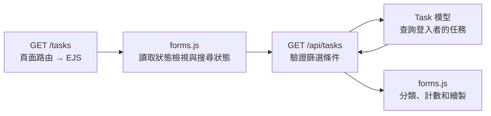

# 組員 3｜任務列表、搜尋、篩選、完成及重開

## 負責範圍

負責登入後的 **Tasks** 頁、即時標題搜尋、狀態篩選、計數，以及完成和重開操作。狀態變更後，頁面沿用列表查詢流程重新載入資料並更新兩張狀態卡。完成和重開使用組員 4 維護的任務更新 API。 [任務寫入及 cURL 示範](./member-04-task-write-curl.md)

## 程式碼地圖

| 檔案 | 接收、處理及輸出 |
| --- | --- |
| [`server.js`](../server.js#L65) | 檢查任務列表頁和 API 的登入狀態。 |
| [`routes/tasks.js`](../routes/tasks.js#L9) | 從網址讀取 `title` 和 `view`，設定 EJS 可讀取的 `res.locals` 和各個返回連結。 |
| [`views/tasks.ejs`](../views/tasks.ejs#L2) | 輸出搜尋欄、兩張狀態卡、空列表提示及含狀態按鈕的 `#task-row` 模板。 |
| [`public/forms.js`](../public/forms.js#L175) | `initializeTaskList` 綁定搜尋及狀態按鈕事件，透過 `loadTaskList` 取資料，再把可見任務各交給 `buildTaskRow` 繪製。 |
| [任務查詢](../routes/api.js#L18) · [任務更新](../routes/api.js#L48) | GET 按登入者 ID 及篩選條件查詢 MongoDB。PUT 驗證提交的欄位，用登入者 ID 和任務 ID 定位並更新同一筆資料。 |
| [`task-input.js`](../task-input.js#L71) · [`models/Task.js`](../models/Task.js#L20) | 前者把搜尋文字和狀態轉為查詢條件或欄位錯誤，後者定義任務欄位及 `userId`、`createdAt` 複合索引。 |

## 操作及請求流程



### 開啟頁面及載入資料

1. `GET /tasks` 先經過 `requirePageLogin`，未登入會轉到 `/login`。登入後，頁面路由用 `readTaskFilters` 驗證網址中的 `title`，整理成 `searchTitle`。只有 `view=completed` 會選取 **Completed**，其餘情況顯示 **In progress**。路由把 `completed`、`searchTitle` 和狀態檢視連結放進 `res.locals`，再渲染 Tasks 模板。`viewQuery` 是加在新增連結上的查詢字串，`returnUrl` 則是表單的返回連結。 [登入檢查](../server.js#L65) · [頁面路由](../routes/tasks.js#L9)
2. EJS 用 locals 預填搜尋欄和連結，並把狀態檢視及關鍵字存入 `#task-page` 的 `data-view` 和 `data-search-title`。瀏覽器的 `initialize` 找到 `#task-page` 後呼叫 `initializeTaskList`，讀取上次新增或編輯後留在 `sessionStorage` 的成功提示，綁定事件，再用 `reload` 進行第一次載入。 [EJS 欄位](../views/tasks.ejs#L2) · [初始化入口](../public/forms.js#L308) · [列表初始化及首次載入](../public/forms.js#L175) · [讀取後清除提示](../public/forms.js#L14)
3. `loadTaskList` 從 `page.dataset.searchTitle` 讀到關鍵字，用 `URLSearchParams` 組成 `GET /api/tasks?title=…`。空白搜尋省略 `title`。請求自動附上同源 Session Cookie。頁面上的兩張卡需要從同一份結果計數，因此這個請求涵蓋兩種狀態。直接呼叫 API 時可額外加上 `status=In%20Progress` 或 `status=Completed`。 [組合查詢網址](../public/forms.js#L143) · [請求函式](../public/forms.js#L41) · [API 狀態篩選](../task-input.js#L93)
4. `readTaskFilters(req.query)` 檢查 `title` 和 `status` 是否各為單一字串，再去除首尾空白。標題上限是 120 個字元。有標題時會先轉義 `[`、`.` 等正則表達式符號，然後用 `i` 選項作不分大小寫的部分比對。合法的狀態條件可和標題條件一併套用。驗證失敗回傳 `400` 和 `fields`。 [篩選驗證](../task-input.js#L71) · [錯誤回應](../routes/api.js#L18)

`GET /api/tasks` 把篩選條件和登入者 `req.user.id` 交給 Task 模型，按建立時間由新至舊排序。`lean()` 讓結果以普通物件回傳。成功時回傳 `200` 和 JSON 陣列，沒有相符任務時陣列為空。 [查詢及回應](../routes/api.js#L24)

```js
const tasks = await Task.find({ userId: req.user.id, ...query })
  .sort({ createdAt: -1 }).lean();
return res.json(tasks);
```

#### 以一組資料追蹤查詢結果

假設目前登入的是測試帳戶甲，香港日期是 2026-11-22。下表是用來推演查詢的資料，任務按建立時間由新至舊排列。

| 任務 | 擁有者 | 標題 | 狀態 | 截止日期 |
| --- | --- | --- | --- | --- |
| D | 帳戶乙 | `Report [Q1] handoff` | `In Progress` | 無 |
| C | 帳戶甲 | `Report Q1 notes` | `In Progress` | 無 |
| B | 帳戶甲 | `report [q1] review` | `Completed` | 無 |
| A | 帳戶甲 | `Report [Q1] draft` | `In Progress` | `2026-11-20` |

1. **網址進入 EJS。** 開啟 `/tasks?view=completed&title=report+%5Bq1%5D` 時，頁面路由收到解碼後的 `req.query.title === 'report [q1]'`。它把 `completed: true` 和 `searchTitle: 'report [q1]'` 傳給 EJS。頁面輸出 `data-view="completed"` 和 `data-search-title="report [q1]"`。 [路由 locals](../routes/tasks.js#L14) · [Tasks 模板](../views/tasks.ejs#L2)
2. **DOM 狀態進入查詢。** `loadTaskList` 讀取 `dataset.searchTitle`，發出 `GET /api/tasks?title=report+%5Bq1%5D`。`readTaskFilters` 產生 `/report \[q1\]/i`，所以方括號也要在標題中出現。API 將正則表達式和 `userId: req.user.id` 合成查詢，再按 `createdAt: -1` 排序。任務 D 因擁有者被排除，C 因標題被排除，JSON 陣列依次回傳 B、A。 [組合查詢](../public/forms.js#L143) · [轉義與比對](../task-input.js#L85) · [資料庫查詢](../routes/api.js#L24)
3. **JSON 進入畫面。** 已完成及未完成各有一筆，兩張卡各顯示 1。此時 `data-view` 為 `completed`，列表只畫 B。切換到 **In progress** 時，連結保留 `title`、省略 `view`。同一查詢仍取回 B、A，但瀏覽器改畫 A，並因香港當天已過截止日而顯示 **Overdue**。 [狀態連結](../views/tasks.ejs#L18) · [分類與繪製](../public/forms.js#L156) · [截止日期顯示](../public/forms.js#L127)

若 REST 呼叫者在同一請求加上 `status=Completed`，MongoDB 會同時要求標題及狀態相符，結果只剩 B。列表頁使用網址的 `view` 來選擇要繪製的狀態檢視，因此仍會取得 A 來計算未完成數量。 [狀態篩選](../task-input.js#L93) · [列表請求與計數](../public/forms.js#L143)

### 搜尋、狀態檢視及畫面更新

1. `syncSearch` 修剪搜尋文字、更新 `data-search-title` 和清除按鈕，再透過 `taskPageUrl` 重組兩張狀態卡、**Add task** 和現有 **Edit** 連結。它亦用 `history.replaceState` 更新目前網址，讓重新整理、切換狀態檢視和從表單返回時可保留搜尋條件。按狀態卡會開啟同一個列表頁，由網址的 `view` 決定選取的狀態。 [網址產生](../public/forms.js#L100) · [同步搜尋及連結](../public/forms.js#L185)
2. 一般輸入每次重設 300 毫秒計時器。中文輸入法開始組字時，程式會取消計時並使舊請求失效，待選字完成後才重新計時。未在組字時按 Enter 會立即查詢。按清除按鈕會清空搜尋欄，立即重查並把焦點放回搜尋欄。 [輸入及清除事件](../public/forms.js#L216)
3. `loadTaskList` 發出請求前記下新增的版本號，收到結果或查詢錯誤時，檢查版本是否仍相同。輸入一有變動就更新版本，即使下一次查詢仍在等 300 毫秒，較舊的結果或錯誤都不會覆蓋目前列表。 [版本比對](../public/forms.js#L143)
4. 新結果按 `status === 'Completed'` 分成已完成和未完成兩組。瀏覽器先寫入兩張卡的數量，再按 `data-view` 選取其中一組，用 `DocumentFragment` 組好該組任務列後一次取代列表。若該狀態檢視沒有相符項目，顯示對應的空列表提示。有關鍵字時顯示 **No matching tasks**。 [分類、計數和空列表](../public/forms.js#L156)
5. `buildTaskRow` 複製 EJS 的 `#task-row`，把 `_id` 和 `status` 存在每列的 `data-task-id` 和 `data-status`。標題和描述按純文字填入。完成狀態決定按鈕標籤及勾號。若有到期日，程式用 ISO 日期首十個字元顯示日期，並跟香港當天日期比較。只有未完成且早於當天的任務顯示 **Overdue**。 [任務列模板](../views/tasks.ejs#L34) · [任務列繪製](../public/forms.js#L111) · [香港時區設定](../public/forms.js#L7)

計時與版本是兩個檢查點。`clearTimeout` 取消未發出的搜尋，版本號則讓已在等回應的舊查詢失效。 [計時處理](../public/forms.js#L216)

```js
const scheduleSearch = () => {
  clearTimeout(searchTimer);
  searchState.version += 1;
  syncSearch();
  if (!composing) searchTimer = setTimeout(searchNow, 300);
};
```

#### 計時器、版本號及中文輸入法

以下假設瀏覽器只觸發表中的事件。每一次開始載入都會增加版本號，輸入改變或開始組字也會增加版本號，以使等待中的請求過期。 [載入版本](../public/forms.js#L143) · [輸入事件](../public/forms.js#L216)

| 時間 | 事件 | 版本及效果 |
| --- | --- | --- |
| 0 毫秒 | 剛開啟列表 | `reload` 發出版本 1 的 GET。 |
| 50 毫秒 | 輸入 `r` | 版本變為 2。網址更新，預定 350 毫秒搜尋。 |
| 100 毫秒 | 輸入 `re` | 版本變為 3。取消上個計時器，改為 400 毫秒搜尋。 |
| 220 毫秒 | 版本 1 的回應抵達 | 目前版本為 3，舊回應略過。 |
| 400 毫秒 | 計時器觸發 | `searchNow → reload → loadTaskList` 發出版本 4 的 GET，關鍵字為 `re`。 |
| 450、475 毫秒 | 開始組字，然後觸發一次輸入 | 組字開始使版本變為 5，輸入再變為 6。兩步均無新 GET。 |
| 540 毫秒 | 完成組字，搜尋欄為 `報告` | 版本變為 7，預定 840 毫秒搜尋。 |
| 600 毫秒 | 版本 4 的回應抵達 | 目前版本為 7，舊回應略過。 |
| 840 毫秒 | 計時器觸發 | 以 `報告` 發出版本 8 的 GET，若回應抵達時仍是版本 8，就更新畫面。 |

`try` 內等候的是同一個帶 Session 的 GET。失效請求的錯誤在 `catch` 返回，失效請求的資料在 `if` 返回，因此兩條路徑都到不了分類和繪製。 [結果與例外分支](../public/forms.js#L148)

```js
let tasks;
try {
  tasks = await request('/api/tasks' + (query.size ? '?' + query.toString() : ''));
} catch (error) {
  if (version !== searchState.version) return;
  throw error;
}
// Ignore an older response, including while a newer query is waiting for its debounce.
if (!tasks || version !== searchState.version) return;
```

### 完成及重開任務

1. 點擊狀態按鈕時，`initializeTaskList` 從任務列讀取 `data-task-id` 和 `data-status`。未完成的任務提交 `{"status":"Completed"}`，已完成的任務提交 `{"status":"In Progress"}`。處理期間，點擊的按鈕會暫時停用，其他列表寫入事件會被略過。 [列表操作](../public/forms.js#L244)
2. 前端透過 `PUT /api/tasks/:id` 送出 JSON、同源 Session Cookie 和 `X-CSRF-Token`。API 驗證狀態後，以任務 ID 和登入者 ID 找到該筆任務，並用 `$set` 更新提交的 `status`。原有標題、描述及截止日期都會保留。成功時回傳 `200` 和更新後的任務。 [共用請求函式](../public/forms.js#L41) · [更新路由](../routes/api.js#L48)
3. 畫面顯示 **Task completed.** 或 **Task reopened.**，按目前搜尋條件重新查詢。兩張狀態卡的數字一併更新，任務會出現在對應的狀態檢視。若正在以中文輸入法組字，搜尋流程會在組字完成後重新查詢。處理結束後，程式會解除寫入鎖定。 [重查及組字檢查](../public/forms.js#L201) · [成功提示及解除鎖定](../public/forms.js#L261)

## 失敗時會發生甚麼

| 情況 | 畫面或 API 反應 |
| --- | --- |
| 頁面網址的 `title` 無效 | 頁面路由回傳 `400` 並渲染錯誤頁。 [頁面查詢驗證](../routes/tasks.js#L9) |
| API 的搜尋條件無效 | API 回傳 `400` 及欄位錯誤，`reload` 將目前查詢的錯誤顯示在頁首。成功重查會清除該提示。 [API 驗證](../routes/api.js#L19) · [畫面錯誤處理](../public/forms.js#L201) |
| Session 失效 | API 回傳 `401`，前端清除暫存提示並轉到 `/login`。 [登入中介層](../routes/auth.js#L51) · [前端跳轉](../public/forms.js#L20) · [請求處理](../public/forms.js#L49) |
| 狀態更新的輸入無效、驗證碼不符或找不到該帳戶名下的任務 | 分別回傳 `400`、`403` 或 `404`。前端顯示錯誤並恢復按鈕。`403` 會清除快取的驗證碼，讓下次寫入時重新取得。 [更新路由](../routes/api.js#L48) · [驗證碼及請求處理](../public/forms.js#L49) · [操作錯誤處理](../public/forms.js#L265) |
| 狀態已更新，但隨後的列表查詢失敗 | 成功提示可與重查錯誤同時顯示。列表保留上次成功繪製的結果，重新整理可核對已儲存的狀態。 [重查錯誤](../public/forms.js#L201) · [操作後重查](../public/forms.js#L261) |

### 排查畫面

- **為甚麼顯示 No matching tasks，但另一張卡有數字？** 先看 `data-view`。空提示取決於目前狀態檢視的 `visible.length`，兩張卡分別取自同一搜尋結果的兩組數量。有搜尋文字時即使另一組有資料，當前狀態檢視沒有結果仍顯示 **No matching tasks**。沒有搜尋文字時，則按狀態檢視顯示 **No completed tasks yet** 或 **No unfinished tasks**。 [空列表條件](../public/forms.js#L156)
- **網址已改，列表為甚麼還未改？** `syncSearch` 在輸入事件中已更新網址和連結。列表等待新請求回來才會替換。在瀏覽器的 **Network** 面板可比對最新 GET 的 `title`，再檢查回應中的 `status` 與目前狀態檢視。 [網址同步](../public/forms.js#L185) · [等待及繪製](../public/forms.js#L143)

## 示範與口頭講解

在本機啟動 TaskFlow，註冊一個全新的測試帳戶並登入。 [本機啟動指引](./setup.md)

1. 新增 `ListDemo Alpha` 和 `ListDemo Beta`。把 Alpha 的截止日期設為香港今天之前，並先在列表將 Beta 標為完成。
2. 在 **In progress** 搜尋 `listdemo`，兩張卡各顯示 1，列表只顯示 Alpha 及 **Overdue**。切換到 **Completed** 並重新整理，列表顯示 Beta，網址仍含 `view=completed` 和 `title=listdemo`。
3. 在瀏覽器的 **Network** 面板觀察連續輸入後的 GET 和 `title` 參數。試一個沒有結果的關鍵字，再按清除按鈕，確認焦點回到搜尋欄。
4. 搜尋 `listdemo` 並回到 **In progress**，將 Alpha 標為完成。確認出現 **Task completed.**，未完成及已完成的數量分別變為 0 和 2。切到 **Completed** 重開 Alpha，確認出現 **Task reopened.**，兩張卡各回到 1。用 **Network** 面板核對兩次 PUT 都只提交 `status`，後續 GET 沿用 `title=listdemo`。

> 我負責任務列表、即時搜尋、狀態篩選，以及完成和重開任務。瀏覽器按網址的搜尋條件查詢登入者的任務，用同一份結果更新兩張狀態卡。停止輸入 300 毫秒後才送出搜尋請求，版本號會防止舊回應覆蓋新結果。完成和重開只提交新的狀態，成功後沿用目前的搜尋條件重新載入，讓任務出現在對應的狀態檢視。
