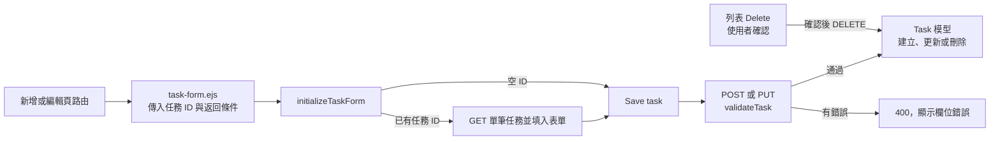

# 組員 4｜修改、刪除及資料驗證

## 負責範圍

說明新增和編輯如何共用表單、瀏覽器與伺服器各自驗證甚麼，以及修改和刪除如何限定為登入者名下的任務。

## 程式碼地圖

| 檔案 | 接收、處理及輸出 |
| --- | --- |
| [`routes/tasks.js`](../routes/tasks.js#L9) | 從頁面網址取得 `title` 和 `view`，設定返回列表的條件。新增和編輯路由把標題及任務 ID 傳給同一份 EJS 模板。 |
| [`views/task-form.ejs`](../views/task-form.ejs#L4) · [`views/tasks.ejs`](../views/tasks.ejs#L34) | 表單提供輸入欄、錯誤位置、取消連結和 `data-*` 資料。列表的任務列模板提供 **Edit** 和 **Delete** 選項。 |
| [`public/forms.js`](../public/forms.js#L284) | `initializeTaskForm` 決定是否預載資料及使用 POST 或 PUT。`handleForm` 管理送出狀態，`showFieldErrors` 負責顯示欄位錯誤。列表的點擊處理器負責刪除。 [共用表單處理](../public/forms.js#L65) · [刪除事件](../public/forms.js#L245) |
| [`server.js`](../server.js#L79) · [`routes/auth.js`](../routes/auth.js#L51) | 先檢查登入狀態及寫入請求的 CSRF 驗證碼，再解析 JSON 和交給 API 路由。 |
| [`routes/api.js`](../routes/api.js#L10) | 檢查任務 ID 格式，呼叫共用驗證函式，並依請求種類讀取、建立、修改或刪除資料。 |
| [`task-input.js`](../task-input.js#L14) · [`models/Task.js`](../models/Task.js#L6) | 前者回傳整理後的欄位和錯誤，後者定義 MongoDB 欄位、擁有者、預設值和模型驗證。 |

## 操作及請求流程



### 開啟共用表單

1. 從列表按 **Add task** 會開啟 `/tasks/new`，路由用空的 `taskId` 渲染 `task-form.ejs`。在 **⋯** 選單按 **Edit** 會開啟 `/tasks/:id/edit`，路由先驗證 ObjectId 格式，再把 ID 傳入同一個模板。兩個頁面都先通過頁面登入檢查。 [頁面登入](../server.js#L65) · [新增與編輯路由](../routes/tasks.js#L35)
2. 模板以 `data-task-id`、`data-view` 和 `data-search-title` 把 ID、分頁和搜尋文字傳給瀏覽器。**Cancel** 用路由的 `returnUrl` 返回同一個篩選結果。初始的 `fieldset` 為停用狀態，等 `initializeTaskForm` 準備好欄位才啟用。 [返回條件](../routes/tasks.js#L14) · [表單模板](../views/task-form.ejs#L4)
3. 新增頁的 ID 為空，程式直接啟用空表單。編輯頁有 ID，程式先發出 `GET /api/tasks/:id`。API 檢查 ID 格式後，用 `_id` 和登入者的 `userId` 查詢。收到 `200` 和任務資料後，程式填入標題、描述及 ISO 日期首十個字元，才啟用表單。只有找到登入者名下的任務才會完成預載。 [表單初始化](../public/forms.js#L284) · [ID 格式檢查](../routes/api.js#L10) · [單筆讀取](../routes/api.js#L29)

### 提交、驗證和寫入

1. HTML 表單要求標題有值、限制標題和描述的長度，並用日期輸入欄。通過瀏覽器檢查後，`handleForm` 攔截送出事件，以 `data-submitting` 及停用送出按鈕防止連按。處理結束時解除鎖定。 [輸入欄設定](../views/task-form.ejs#L7) · [表單事件](../public/forms.js#L65)
2. `initializeTaskForm` 清除舊錯誤，用 `FormData` 收集標題、描述和截止日期。空 ID 走 `POST /api/tasks`，有 ID 走 `PUT /api/tasks/:id`。編輯表單提交這三個欄位，所以現有狀態會保留。列表的完成按鈕另用同一個 PUT 端點只提交 `status`。共用的 `request` 將內容轉為 JSON、送出同源 Cookie，並在寫入請求附上 `X-CSRF-Token`。伺服器依序查登入狀態、驗證 CSRF、解析最多 16 KB 的 JSON，再交給任務路由。 [送出表單](../public/forms.js#L294) · [請求函式](../public/forms.js#L41) · [API 中介層](../server.js#L81) · [組員 3 的狀態切換流程](./member-03-task-list-status.md)

同一個送出處理器用 ID 決定方法，成功後以原本的 `view` 和 `title` 返回列表。成功提示放進 `sessionStorage`，列表初始化時讀取一次並清除。 [送出和返回](../public/forms.js#L297) · [列表讀取提示](../public/forms.js#L175) · [讀取後清除](../public/forms.js#L14)

```js
const body = Object.fromEntries(new FormData(form));
const result = await request(taskApi(id), { method: id ? 'PUT' : 'POST', body });
if (!result) return;
sessionStorage.setItem(messageKey, id ? 'Task updated.' : 'Task added.');
window.location.assign(taskPageUrl('/tasks', form.dataset.view, form.dataset.searchTitle));
```

3. `validateTask` 接收非陣列物件，只讀取允許的欄位 `title`、`description`、`dueDate` 和 `status`。用戶提交的 `_id`、`userId` 或時間戳等欄位會被略過。新增會用空標題、空描述和空日期作初值，再驗證合併後的資料。更新以 `partial: true` 從空物件開始，只檢查已提交的可編輯欄位。若未提交任何可編輯欄位，回傳 `fields._form`。 [輸入類型與欄位白名單](../task-input.js#L14) · [空更新檢查](../task-input.js#L63)

| 欄位 | 伺服器驗證規則 |
| --- | --- |
| `title` | 必須為字串，去除首尾空白後長度須為 1 至 120。 [去除空白](../task-input.js#L44) · [長度檢查](../task-input.js#L54) |
| `description` | 必須為字串，長度上限 1,000，可用空字串清空。 [類型檢查](../task-input.js#L44) · [長度檢查](../task-input.js#L57) |
| `dueDate` | `''` 或 `null` 會轉成空值。其餘輸入須為 `YYYY-MM-DD`。程式轉成 UTC 午夜後再轉回原日期比對，確保拒絕 2 月 30 日等無效日期。 [日期驗證](../task-input.js#L30) |
| `status` | 必須為 `In Progress` 或 `Completed`。新增時省略狀態，Task 模型預設為 `In Progress`。 [狀態選項](../task-input.js#L2) · [狀態驗證](../task-input.js#L60) · [模型預設](../models/Task.js#L14) |

4. POST 和 PUT 有驗證錯誤時都直接回傳 `400` 和 `fields`，不進入資料庫寫入。POST 以 `req.user.id` 設定擁有者，回傳 `201` 及新任務。PUT 同時比對 `_id` 和 `userId`，用 `$set` 寫入已整理的欄位，讓省略的欄位保留。`runValidators` 另外啟用模型驗證，`returnDocument: 'after'` 使 `200` 回應帶回更新後的任務。 [新增 API](../routes/api.js#L36) · [更新 API](../routes/api.js#L48)

```js
const filter = { _id: req.params.id, userId: req.user.id };
const updatedTask = await Task.findOneAndUpdate(filter, { $set: task }, {
  returnDocument: 'after', runValidators: true
});
if (!updatedTask) return res.status(404).json({ error: 'Task not found.' });
```

#### 用同一筆任務逐步推演

假設登入者的 `req.user.id` 是 `65aa00000000000000000001`。下列資料只用於講解，假設新增後 MongoDB 分配的任務 ID 是 `65aa00000000000000000011`。

1. **新增。** 從 `/tasks?title=EditDemo` 按 **Add task**。新增頁的 `data-task-id` 是空字串，因此 `taskApi(id)` 使用 `/api/tasks`，表單以 POST 送出下列 JSON。 [新增路由](../routes/tasks.js#L35) · [選擇 API 網址及方法](../public/forms.js#L107) · [送出表單](../public/forms.js#L294)

   ```json
   {"title":"  EditDemo Original  ","description":"初稿備註","dueDate":"2026-11-30"}
   ```

   `validateTask` 去除標題首尾空白，將日期轉為 JavaScript `Date`。POST 用 Session 恢復出的使用者 ID 設定 `userId`，Task 模型填上預設狀態。以下是 HTTP `201` 回應中的欄位節錄。 [整理欄位](../task-input.js#L23) · [建立紀錄](../routes/api.js#L36) · [模型預設](../models/Task.js#L14)

   ```json
   {
     "_id": "65aa00000000000000000011",
     "userId": "65aa00000000000000000001",
     "title": "EditDemo Original",
     "description": "初稿備註",
     "dueDate": "2026-11-30T00:00:00.000Z",
     "status": "In Progress"
   }
   ```

2. **完成後開啟編輯頁。** 新增成功後返回 `/tasks?title=EditDemo`。列表的完成按鈕向 `PUT /api/tasks/65aa00000000000000000011` 送出 `{"status":"Completed"}`。此次 `$set` 只包含 `status`，所以保留標題、描述和截止日期。切換到 **Completed** 並按 **Edit**，進入 `/tasks/65aa00000000000000000011/edit?view=completed&title=EditDemo`。瀏覽器另發單筆 GET，成功後表單顯示 `EditDemo Original`、`初稿備註` 及 `2026-11-30`。 [列表更新](../public/forms.js#L257) · [產生編輯連結](../public/forms.js#L137) · [帶入欄位](../public/forms.js#L284)
3. **重新命名及清除日期。** 清空日期欄後，該欄仍有 `name="dueDate"`，`FormData` 會收集空字串。編輯表單向同一個任務 URI 送出下面的 PUT JSON。 [日期欄](../views/task-form.ejs#L17) · [收集表單](../public/forms.js#L294)

   ```json
   {"title":"EditDemo Updated","description":"初稿備註","dueDate":""}
   ```

   API 驗證後以 `{ _id: '65aa00000000000000000011', userId: '65aa00000000000000000001' }` 尋找任務，以 `$set` 寫入標題、描述及 `dueDate: null`。API 回傳 `200`。由於這次 JSON 省略狀態，任務仍為 `Completed`。前端把 **Task updated.** 交給 `sessionStorage`，回到 `/tasks?view=completed&title=EditDemo`，列表讀取提示後清除暫存值。 [更新及回傳](../routes/api.js#L48) · [返回列表](../public/forms.js#L297) · [讀取後清除](../public/forms.js#L14)

#### 日期省略、空字串和空值的差別

表內的片段只列出 `dueDate` 的傳法。POST 仍須有有效標題，PUT 至少須提供一個可編輯欄位。 [新增初值](../task-input.js#L6) · [日期清理](../task-input.js#L30) · [局部更新檢查](../task-input.js#L63)

| 輸入 | 新增時 | 更新時 |
| --- | --- | --- |
| 省略 `dueDate` | 初值為 `null`。 | `$set` 省略此欄，保留原來的日期。 |
| `"dueDate": ""` | 儲存為 `null`。 | 儲存為 `null`，清除原來的日期。 |
| `"dueDate": null` | 儲存為 `null`。 | 儲存為 `null`，清除原來的日期。 |
| `"dueDate": "2026-11-30"` | 轉為 UTC 午夜。 | 以該日的 UTC 午夜取代原值。 |
| `"dueDate": "2026-02-30"` | 轉回日曆日期時與輸入不符，回傳 `400`。 | 同樣回傳 `400`，保留原值。 |

### 確認及刪除

1. 在列表選 **⋯ → Delete**，`initializeTaskList` 根據 `data-task-action` 找到該任務。取消確認對話框時，處理器直接返回。確認後暫停列表的更新動作和被點擊按鈕，再帶上 Session Cookie 和 CSRF 驗證碼發出 `DELETE /api/tasks/:id`。 [確認及請求](../public/forms.js#L245)
2. 刪除路由以 `_id` 和 `userId` 執行 `deleteOne`。`deletedCount === 0` 回傳 `404`。成功時回傳 `200` 和 `Task deleted.`，瀏覽器顯示該提示，按原有篩選條件重查列表，最後恢復按鈕。 [刪除 API](../routes/api.js#L65) · [提示、重查與解除鎖定](../public/forms.js#L261)

確認對話框放在設定 `updating` 和停用按鈕之前。按 **Cancel** 時提早返回，原列表及按鈕可繼續使用。按確認後才以任務列的 `dataset.taskId` 組合 DELETE 網址。這次請求沒有 JSON 內容，但仍須帶上 Session Cookie 和 CSRF 驗證碼。 [確認分支](../public/forms.js#L245) · [寫入請求標頭](../public/forms.js#L41)

```js
const deleting = button.dataset.taskAction === 'delete';
if (deleting && !window.confirm('Delete this task?')) return;

updating = true;
button.disabled = true;
```

## 失敗時會發生甚麼

| 情況 | 畫面或 API 反應 |
| --- | --- |
| ID 格式有誤 | 編輯頁渲染 `400` 錯誤頁。單筆 API 的 ID 驗證回傳 `400` JSON。兩者都先於任務資料庫查詢。 [頁面檢查](../routes/tasks.js#L39) · [API 檢查](../routes/api.js#L10) |
| 有效 ID 在這個帳戶中查無任務 | 通過先前的請求檢查後，GET、PUT 或 DELETE 回傳 `404`。編輯頁預載遇到這個錯誤時，頁首顯示錯誤而表單維持停用。 [單筆讀取](../routes/api.js#L29) · [更新及刪除](../routes/api.js#L59) · [初始化錯誤處理](../public/forms.js#L343) |
| 欄位或整份表單無效 | `request` 將 JSON 的 `fields` 放進錯誤物件。頁首提示優先顯示 `fields._form`，其次顯示一般錯誤訊息。`showFieldErrors` 依欄位名稱找訊息，透過 `aria-describedby` 定位訊息元素，並設定或移除 `aria-invalid`。畫面留在原表單，使用者可修正再試。 [解析 API 錯誤](../public/forms.js#L56) · [欄位標記](../public/forms.js#L275) · [錯誤顯示](../public/forms.js#L302) |
| Session 失效、CSRF 驗證或 JSON 解析失敗 | 分別回傳 `401`、`403` 或適用的 `4xx`，例如 JSON 格式有誤時回傳 `400`，超出大小上限時回傳 `413`。前端收到 `401` 轉到登入頁，收到 `403` 時清除快取的 CSRF 驗證碼，供下次寫入時重新取得。 [表單請求](../public/forms.js#L41) · [登入與 CSRF 檢查](../routes/auth.js#L51) · [解析錯誤](../server.js#L81) |
| 寫入發生其他伺服器錯誤 | API 例外會交給 Express 的錯誤處理器，回傳通用 `500` JSON。前端在頁首顯示錯誤，解除表單或列表按鈕的忙碌狀態。 [伺服器錯誤處理](../server.js#L85) · [表單解除鎖定](../public/forms.js#L75) · [列表解除鎖定](../public/forms.js#L265) |

### 從錯誤回應追到欄位

在測試帳戶把標題改為三個空格。文字欄有值，所以可通過 HTML 的 `required` 檢查。伺服器執行 `trim()` 後取得空字串，因此 `validateTask` 設定 `errors.title`，PUT 回傳 HTTP `400`。資料庫更新在這個返回點之後，所以舊標題留在紀錄中。 [表單限制](../views/task-form.ejs#L7) · [清理及長度驗證](../task-input.js#L44) · [PUT 驗證分支](../routes/api.js#L48)

```json
{"error":"Check the task fields.","fields":{"title":"Enter a title of 1 to 120 characters."}}
```

1. `request` 用 `data.error` 建立 Error，附上 `data.fields` 後拋出。`handleForm` 捕捉後把錯誤交給表單的 `onError`。 [建立錯誤物件](../public/forms.js#L56) · [捕捉錯誤](../public/forms.js#L65)
2. `onError` 把一般錯誤寫到頁首的 `#request-error`。若回應含 `fields._form`，頁首優先顯示它。例如 PUT 的 JSON 是 `{}` 時，`fields._form` 是 **Provide at least one editable task field.**。 [表單錯誤優先次序](../public/forms.js#L302) · [頁首錯誤位置](../views/partials/header.ejs#L23) · [空更新錯誤](../task-input.js#L63)
3. `showFieldErrors` 以 `name="title"` 取得 `fields.title`，為輸入欄加上 `aria-invalid="true"`，再循 `aria-describedby="title-error"` 找到 `#title-error` 並顯示訊息。再次送出時會先清除舊的頁首和欄位錯誤，送出按鈕由 `finally` 恢復。 [欄位與錯誤元素](../views/task-form.ejs#L7) · [顯示及清除欄位錯誤](../public/forms.js#L275) · [送出前清除](../public/forms.js#L294) · [恢復按鈕](../public/forms.js#L75)

### 排查停在哪一步

- **為甚麼看不到 POST 或 PUT？** 確認編輯預載的 GET 是否成功，並查看 `fieldset` 是否已啟用。再看瀏覽器有沒有因 `required` 擋下送出，以及是否在等候 `GET /api/auth/csrf`。 [預載及啟用](../public/forms.js#L284) · [HTML 驗證](../views/task-form.ejs#L7) · [取得 CSRF 驗證碼](../public/forms.js#L27)
- **同樣是 400，怎樣分辨哪一關出錯？** 伺服器先查登入和 CSRF，再解析 JSON。其後 `router.param` 驗證 ID，PUT 最後用 `validateTask` 檢查欄位。JSON 解析失敗的通用訊息是 **Invalid request data.**，ID 格式錯誤是 **Invalid task ID.**，欄位錯誤則附上 `fields`。 [中介層及解析器](../server.js#L81) · [ID 驗證](../routes/api.js#L10) · [欄位驗證](../routes/api.js#L48)
- **有成功提示，但在列表找不到剛編輯的任務？** 回到列表後仍會用原有 `title` 重新搜尋。若改名後標題與該關鍵字不符，畫面便省略該任務。可清除搜尋，再查看它所屬的狀態分頁。 [保留網址條件](../public/forms.js#L297) · [列表的標題查詢及分組](../public/forms.js#L143)

## 示範與口頭講解

1. 用自己的測試帳戶新增 `EditDemo Original`，填寫描述和日期。在列表搜尋 `EditDemo` 後開啟 **Edit**，確認三個欄位已預填。按 **Cancel** 可返回同一搜尋結果。
2. 再次開啟 **Edit**，把標題改成只有空格後儲存。在瀏覽器的 **Network** 面板確認回傳 `400`，標題旁顯示 **Enter a title of 1 to 120 characters.**。再輸入 `EditDemo Updated`、清空日期及儲存。確認 **Task updated.** 出現，返回的列表仍保留搜尋。在 **Network** 面板對照送出的欄位與回應，回應的 `dueDate` 為 `null`，任務的 `status` 保留原值。
3. 選 **Delete** 後先取消，確認任務仍在。再選 **Delete** 並確認，畫面顯示 **Task deleted.**，重新載入的列表移除該筆資料。 [cURL 示範的驗證步驟](../README.zh-Hant.md#curl-示範)

> 講解時從 `data-task-id` 開始，比較新增及編輯的預載和提交路徑。用只有空格的標題展示伺服器如何回傳 `fields.title`，再指出 `showFieldErrors` 如何把訊息放到正確欄位。最後沿着 PUT 的 `$set` 和 DELETE 的 `deleteOne` 解釋兩者如何用任務 ID 和登入者 ID 核對擁有者。
