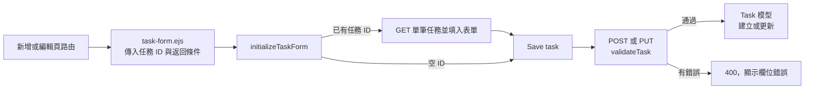

# 組員 4｜新增、編輯及刪除任務

## 負責範圍

負責新增和編輯任務的共用表單、欄位驗證、單筆任務預載，以及刪除確認和 API，並整理 cURL 整合示範。組員 4 維護共用的 `PUT /api/tasks/:id`。編輯表單提交任務內容，組員 3 的狀態按鈕也使用此端點提交 `status`。 [組員 3 的狀態切換流程](./member-03-task-list-status.md) · [cURL 示範](../README.zh-Hant.md#curl-示範)

## 程式碼地圖

| 檔案 | 接收、處理及輸出 |
| --- | --- |
| [`routes/tasks.js`](../routes/tasks.js#L9) | 從頁面網址取得 `title` 和 `view`，設定返回列表的條件。新增和編輯路由把標題及任務 ID 傳給同一份 EJS 模板。 |
| [`views/task-form.ejs`](../views/task-form.ejs#L4) · [`views/tasks.ejs`](../views/tasks.ejs#L34) | 表單提供輸入欄、錯誤位置、取消連結和 `data-*` 資料。列表的任務列模板提供 **Edit** 和 **Delete**。 |
| [`public/forms.js`](../public/forms.js#L265) | `initializeTaskForm` 決定是否預載資料及使用 POST 或 PUT。`handleForm` 管理送出狀態，`showFieldErrors` 負責顯示欄位錯誤。 [共用表單處理](../public/forms.js#L46) |
| [列表操作處理](../public/forms.js#L225) | 處理刪除確認、提交 DELETE 並重查列表。 |
| [`server.js`](../server.js#L79) · [`routes/auth.js`](../routes/auth.js#L50) | 先檢查登入狀態和寫入來源，再解析 JSON 和交給 API 路由。 |
| [`routes/api.js`](../routes/api.js#L10) | 檢查任務 ID 格式，依請求種類讀取單筆、建立、更新或刪除資料。新增和更新使用共用欄位驗證。 |
| [`task-input.js`](../task-input.js#L14) · [`models/Task.js`](../models/Task.js#L6) | 前者回傳整理後的欄位和錯誤，後者定義 MongoDB 欄位、擁有者、預設值和模型驗證。 |

## 操作及請求流程



### 開啟共用表單

1. 從列表按 **Add task** 會開啟 `/tasks/new`，路由用空的 `taskId` 渲染 `task-form.ejs`。在 **⋯** 選單按 **Edit** 會開啟 `/tasks/:id/edit`，路由先驗證 ObjectId 格式，再把 ID 傳入同一個模板。兩個頁面都先通過頁面登入檢查。 [頁面登入](../server.js#L65) · [新增與編輯路由](../routes/tasks.js#L35)
2. 模板以 `data-task-id`、`data-view` 和 `data-search-title` 把 ID、狀態檢視和搜尋文字傳給瀏覽器。**Cancel** 用路由的 `returnUrl` 返回同一個篩選結果。初始的 `fieldset` 為停用狀態，等 `initializeTaskForm` 準備好欄位才啟用。 [返回條件](../routes/tasks.js#L14) · [表單模板](../views/task-form.ejs#L4)
3. 新增頁的 ID 為空，程式直接啟用空表單。編輯頁有 ID，程式先發出 `GET /api/tasks/:id`。API 檢查 ID 格式後，用 `_id` 和登入者的 `userId` 查詢。收到 `200` 和任務資料後，程式填入標題、描述及 ISO 日期首十個字元，才啟用表單。只有找到登入者名下的任務才會完成預載。 [表單初始化](../public/forms.js#L265) · [ID 格式檢查](../routes/api.js#L10) · [單筆讀取](../routes/api.js#L29)

### 提交、驗證和寫入

1. HTML 表單要求標題有值、限制標題和描述的長度，並用日期輸入欄。通過瀏覽器檢查後，`handleForm` 攔截送出事件，以 `data-submitting` 及停用送出按鈕防止連按。處理結束時解除鎖定。 [輸入欄設定](../views/task-form.ejs#L7) · [表單事件](../public/forms.js#L46)
2. `initializeTaskForm` 清除舊錯誤，用 `FormData` 收集標題、描述和截止日期。空 ID 走 `POST /api/tasks`，有 ID 走 `PUT /api/tasks/:id`。編輯表單提交這三個欄位，所以現有狀態會保留。列表的完成按鈕另用同一個 PUT 端點只提交 `status`。共用的 `request` 將內容轉為 JSON，並附上同源 Cookie。伺服器依序查登入狀態、檢查寫入來源和內容類型、解析最多 16 KB 的 JSON，再交給任務路由。 [送出表單](../public/forms.js#L275) · [請求函式](../public/forms.js#L25) · [API 中介層](../server.js#L81) · [組員 3 的狀態切換流程](./member-03-task-list-status.md)

同一個送出處理器用 ID 決定方法，成功後以原本的 `view` 和 `title` 返回列表。成功提示放進 `sessionStorage`，列表初始化時讀取一次並清除。 [送出和返回](../public/forms.js#L278) · [列表讀取提示](../public/forms.js#L156) · [讀取後清除](../public/forms.js#L14)

```js
const body = Object.fromEntries(new FormData(form));
const result = await request(taskApi(id), { method: id ? 'PUT' : 'POST', body });
if (!result) return;
sessionStorage.setItem(messageKey, id ? 'Task updated.' : 'Task added.');
window.location.assign(taskPageUrl('/tasks', form.dataset.view, form.dataset.searchTitle));
```

3. `validateTask` 接收非陣列物件，只讀取允許的欄位 `title`、`description`、`dueDate` 和 `status`。用戶提交的 `_id`、`userId` 或時間戳等欄位會被略過。新增會用空標題、空描述和空日期作初值，再驗證合併後的資料。更新以 `partial: true` 從空物件開始，只檢查已提交的可編輯欄位。若未提交任何可編輯欄位，回傳 `fields._form`。 [輸入類型與欄位白名單](../task-input.js#L14) · [空更新檢查](../task-input.js#L63)

| 欄位 | 伺服器驗證規則 |
| --- | --- |
| `title` | 必須為字串，去除首尾空白後長度須為 1 至 120。 [去除空白](../task-input.js#L44) · [長度檢查](../task-input.js#L54) |
| `description` | 必須為字串，長度上限 1,000，可用空字串清空。 [類型檢查](../task-input.js#L44) · [長度檢查](../task-input.js#L57) |
| `dueDate` | `''` 或 `null` 會轉成空值。其餘輸入須為 `YYYY-MM-DD`。程式轉成 UTC 午夜後再轉回原日期比對，確保拒絕 2 月 30 日等無效日期。 [日期驗證](../task-input.js#L30) |
| `status` | 必須為 `In Progress` 或 `Completed`。新增時省略狀態，Task 模型預設為 `In Progress`。 [狀態選項](../task-input.js#L2) · [狀態驗證](../task-input.js#L60) · [模型預設](../models/Task.js#L14) |

4. POST 和 PUT 有驗證錯誤時都直接回傳 `400` 和 `fields`，不進入資料庫寫入。POST 以 `req.user.id` 設定擁有者，回傳 `201` 及新任務。PUT 同時比對 `_id` 和 `userId`，用 `$set` 寫入已整理的欄位，讓省略的欄位保留。`runValidators` 另外啟用模型驗證，`returnDocument: 'after'` 使 `200` 回應帶回更新後的任務。 [新增 API](../routes/api.js#L36) · [更新 API](../routes/api.js#L48)

```js
const filter = { _id: req.params.id, userId: req.user.id };
const updatedTask = await Task.findOneAndUpdate(filter, { $set: task }, {
  returnDocument: 'after', runValidators: true
});
if (!updatedTask) return res.status(404).json({ error: 'Task not found.' });
```

#### 用同一筆任務逐步推演

假設登入者的 `req.user.id` 是 `65aa00000000000000000001`。下列資料只用於講解，假設新增後 MongoDB 分配的任務 ID 是 `65aa00000000000000000011`。

1. **新增。** 從 `/tasks?title=EditDemo` 按 **Add task**。新增頁的 `data-task-id` 是空字串，因此 `taskApi(id)` 使用 `/api/tasks`，表單以 POST 送出下列 JSON。 [新增路由](../routes/tasks.js#L35) · [選擇 API 網址及方法](../public/forms.js#L88) · [送出表單](../public/forms.js#L275)

   ```json
   {"title":"  EditDemo Original  ","description":"初稿備註","dueDate":"2026-11-30"}
   ```

   `validateTask` 去除標題首尾空白，將日期轉為 JavaScript `Date`。POST 用 Session 恢復出的使用者 ID 設定 `userId`，Task 模型填上預設狀態。以下是 HTTP `201` 回應中的欄位節錄。 [整理欄位](../task-input.js#L23) · [建立紀錄](../routes/api.js#L36) · [模型預設](../models/Task.js#L14)

   ```json
   {
     "_id": "65aa00000000000000000011",
     "userId": "65aa00000000000000000001",
     "title": "EditDemo Original",
     "description": "初稿備註",
     "dueDate": "2026-11-30T00:00:00.000Z",
     "status": "In Progress"
   }
   ```

2. **完成後開啟編輯頁。** 新增成功後返回 `/tasks?title=EditDemo`。列表的完成按鈕向 `PUT /api/tasks/65aa00000000000000000011` 送出 `{"status":"Completed"}`。此次 `$set` 只包含 `status`，所以保留標題、描述和截止日期。切換到 **Completed** 並按 **Edit**，進入 `/tasks/65aa00000000000000000011/edit?view=completed&title=EditDemo`。瀏覽器另發單筆 GET，成功後表單顯示 `EditDemo Original`、`初稿備註` 及 `2026-11-30`。 [列表更新](../public/forms.js#L238) · [產生編輯連結](../public/forms.js#L118) · [帶入欄位](../public/forms.js#L265)
3. **重新命名及清除日期。** 清空日期欄後，該欄仍有 `name="dueDate"`，`FormData` 會收集空字串。編輯表單向同一個任務 URI 送出下面的 PUT JSON。 [日期欄](../views/task-form.ejs#L17) · [收集表單](../public/forms.js#L275)

   ```json
   {"title":"EditDemo Updated","description":"初稿備註","dueDate":""}
   ```

   API 驗證後以 `{ _id: '65aa00000000000000000011', userId: '65aa00000000000000000001' }` 尋找任務，以 `$set` 寫入標題、描述及 `dueDate: null`。API 回傳 `200`。由於這次 JSON 省略狀態，任務仍為 `Completed`。前端把 **Task updated.** 交給 `sessionStorage`，回到 `/tasks?view=completed&title=EditDemo`，列表讀取提示後清除暫存值。 [更新及回傳](../routes/api.js#L48) · [返回列表](../public/forms.js#L278) · [讀取後清除](../public/forms.js#L14)

#### 日期省略、空字串和空值的差別

表內的片段只列出 `dueDate` 的傳法。POST 仍須有有效標題，PUT 至少須提供一個可編輯欄位。 [新增初值](../task-input.js#L6) · [日期清理](../task-input.js#L30) · [局部更新檢查](../task-input.js#L63)

| 輸入 | 新增時 | 更新時 |
| --- | --- | --- |
| 省略 `dueDate` | 初值為 `null`。 | `$set` 省略此欄，保留原來的日期。 |
| `"dueDate": ""` | 儲存為 `null`。 | 儲存為 `null`，清除原來的日期。 |
| `"dueDate": null` | 儲存為 `null`。 | 儲存為 `null`，清除原來的日期。 |
| `"dueDate": "2026-11-30"` | 轉為 UTC 午夜。 | 以該日的 UTC 午夜取代原值。 |
| `"dueDate": "2026-02-30"` | 轉回日曆日期時與輸入不符，回傳 `400`。 | 同樣回傳 `400`，保留原值。 |

### 確認及刪除

1. 在任務列表選 **⋯ → Delete**，瀏覽器會顯示 **Delete this task?**。按 **Cancel** 便保留任務，點擊處理器會在停用按鈕和發送請求前返回。 [確認分支](../public/forms.js#L226)
2. 確認後，程式停用被點擊的按鈕並暫時阻止其他列表寫入。瀏覽器向 `DELETE /api/tasks/:id` 送出 登入後的 Session Cookie，使用網址內的 ID 指定任務。 [刪除請求](../public/forms.js#L233) · [共用請求函式](../public/forms.js#L25)
3. API 檢查 ID 格式，再用任務的 `_id` 和登入者的 `userId` 執行 `deleteOne`。找不到符合條件的任務時回傳 `404`，成功時回傳 `200` 及 `{"message":"Task deleted."}`。網頁顯示提示，按目前搜尋條件重查列表，並在操作結束時恢復按鈕。 [ID 檢查](../routes/api.js#L10) · [刪除路由](../routes/api.js#L65) · [重查列表](../public/forms.js#L242)

## 用 cURL 示範新增、查詢、更新及刪除

上台前在示範網站註冊帳戶，執行 README 中對應雲端或本機的登入指令。看到 `{"message":"Signed in."}` 後，在同一個 Bash 終端機逐句示範。 [登入及四條 cURL 原指令](../README.zh-Hant.md#curl-示範)

1. 用 `POST /api/tasks` 新增 `Demo task`。指令會顯示回應，並把 `_id` 存入 `$TASK_ID`。
2. 用 `GET /api/tasks` 讀取任務清單，在陣列中找出相同的 `_id`。
3. 執行 `PUT`。網址會帶入 `$TASK_ID`，回應會顯示 `Completed`。也可以用同一帳戶重新整理網頁展示結果。
4. 最後執行 `DELETE`，確認回應為 `{"message":"Task deleted."}`。

下表是 README 完整驗收另外會核對的項目。 [完整 cURL 測試](../README.zh-Hant.md#curl-示範)

| 請求 | 示範核對項目 |
| --- | --- |
| `POST /api/tasks` | 回傳 `201` 及任務資料，儲存新任務的 `_id`，確認預設狀態為 `In Progress`。 |
| `GET /api/tasks` 及 `GET /api/tasks/:id` | 兩個請求均回傳 `200`，在列表和單筆回應找到相同 ID。 |
| `PUT /api/tasks/:id` | 回傳 `200`，核對新標題及狀態，確認原有描述保留。 |
| `DELETE /api/tasks/:id` 後再次查單筆 | 刪除回傳 `200` 及確認訊息，查詢同一 ID 時回傳 `404`。 |
| `POST /api/auth/logout` | 送出 JSON `{}`，回傳 `204`，伺服器銷毀 Session 並清除 Cookie。 |

`api_call()` 讀寫 Cookie 檔案並逐步核對 HTTP 狀態。示範以 `jq -e` 核對回應內的 ID 和欄位值。它只刪除當次建立的任務，結束時會移除暫存檔案。 [Bash 示範](../README.zh-Hant.md#curl-示範)

## 失敗時會發生甚麼

| 情況 | 畫面或 API 反應 |
| --- | --- |
| ID 格式有誤 | 編輯頁渲染 `400` 錯誤頁。單筆 API 的 ID 驗證回傳 `400` JSON。兩者都先於任務資料庫查詢。 [頁面檢查](../routes/tasks.js#L39) · [API 檢查](../routes/api.js#L10) |
| 有效 ID 在這個帳戶中查無任務 | 單筆查詢、更新和刪除都回傳 `404`。若編輯預載失敗，表單維持停用。若刪除失敗，列表顯示錯誤並恢復按鈕。 [單筆讀取](../routes/api.js#L29) · [任務更新](../routes/api.js#L59) · [刪除路由](../routes/api.js#L65) · [列表錯誤處理](../public/forms.js#L246) |
| 欄位或整份表單無效 | `request` 將 JSON 的 `fields` 放進錯誤物件。頁首提示優先顯示 `fields._form`，其次顯示一般錯誤訊息。`showFieldErrors` 依欄位名稱找訊息，透過 `aria-describedby` 定位訊息元素，並設定或移除 `aria-invalid`。畫面留在原表單，使用者可修正再試。 [解析 API 錯誤](../public/forms.js#L37) · [欄位標記](../public/forms.js#L256) · [錯誤顯示](../public/forms.js#L283) |
| Session 失效、跨來源寫入或 JSON 格式有誤 | `401` 會導回登入頁。瀏覽器標示跨來源寫入會回傳 `403`。`POST` 或 `PUT` 的內容類型錯誤會回傳 `415`，JSON 無法解析或超出大小上限分別是 `400`、`413`。 [請求函式](../public/forms.js#L25) · [寫入檢查](../routes/auth.js#L55) · [解析錯誤](../server.js#L81) |
| 寫入發生其他伺服器錯誤 | API 例外會交給 Express 的錯誤處理器，回傳通用 `500` JSON。前端在頁首顯示錯誤，解除表單按鈕的忙碌狀態。 [伺服器錯誤處理](../server.js#L85) · [表單解除鎖定](../public/forms.js#L56) |
| 刪除成功後列表查詢失敗 | 畫面可能同時顯示刪除成功及重查錯誤。重新整理後，以最新列表核對刪除結果。 [成功提示與重查](../public/forms.js#L242) · [重查錯誤處理](../public/forms.js#L182) |
| cURL 未取得 HTTP 回應，或在狀態符合預期後中止 | 連線錯誤時先核對 `BASE` 和服務日誌。HTTP 狀態已符合預期時，檢查 `jq -e` 核對的欄位值。 [cURL 示範](../README.zh-Hant.md#curl-示範) |

### 從錯誤回應追到欄位

在測試帳戶把標題改為三個空格。文字欄有值，所以可通過 HTML 的 `required` 檢查。伺服器執行 `trim()` 後取得空字串，因此 `validateTask` 設定 `errors.title`，PUT 回傳 HTTP `400`。資料庫更新在這個返回點之後，所以舊標題留在紀錄中。 [表單限制](../views/task-form.ejs#L7) · [清理及長度驗證](../task-input.js#L44) · [PUT 驗證分支](../routes/api.js#L48)

```json
{"error":"Check the task fields.","fields":{"title":"Enter a title of 1 to 120 characters."}}
```

1. `request` 用 `data.error` 建立 Error，附上 `data.fields` 後拋出。`handleForm` 捕捉後把錯誤交給表單的 `onError`。 [建立錯誤物件](../public/forms.js#L37) · [捕捉錯誤](../public/forms.js#L46)
2. `onError` 把一般錯誤寫到頁首的 `#request-error`。若回應含 `fields._form`，頁首優先顯示它。例如 PUT 的 JSON 是 `{}` 時，`fields._form` 是 **Provide at least one editable task field.**。 [表單錯誤優先次序](../public/forms.js#L283) · [頁首錯誤位置](../views/header.ejs#L23) · [空更新錯誤](../task-input.js#L63)
3. `showFieldErrors` 以 `name="title"` 取得 `fields.title`，為輸入欄加上 `aria-invalid="true"`，再循 `aria-describedby="title-error"` 找到 `#title-error` 並顯示訊息。再次送出時會先清除舊的頁首和欄位錯誤，送出按鈕由 `finally` 恢復。 [欄位與錯誤元素](../views/task-form.ejs#L7) · [顯示及清除欄位錯誤](../public/forms.js#L256) · [送出前清除](../public/forms.js#L275) · [恢復按鈕](../public/forms.js#L56)

### 排查停在哪一步

- **為甚麼看不到 POST 或 PUT？** 確認編輯預載的 GET 是否成功，並查看 `fieldset` 是否已啟用。再看瀏覽器有沒有因 `required` 擋下送出。 [預載及啟用](../public/forms.js#L265) · [HTML 驗證](../views/task-form.ejs#L7)
- **同樣是 400，怎樣分辨哪一關出錯？** 伺服器先查登入、寫入來源及內容類型，再解析 JSON。其後 `router.param` 驗證 ID，PUT 最後用 `validateTask` 檢查欄位。JSON 解析失敗的通用訊息是 **Invalid request data.**，ID 格式錯誤是 **Invalid task ID.**，欄位錯誤則附上 `fields`。 [中介層及解析器](../server.js#L81) · [ID 驗證](../routes/api.js#L10) · [欄位驗證](../routes/api.js#L48)
- **有成功提示，但在列表找不到剛編輯的任務？** 回到列表後仍會用原有 `title` 重新搜尋。若改名後標題與該關鍵字不符，畫面便省略該任務。可清除搜尋，再查看它所屬的狀態檢視。 [保留網址條件](../public/forms.js#L278) · [組員 3 的列表查詢](./member-03-task-list-status.md)

## 示範與口頭講解

在本機啟動 TaskFlow，註冊測試帳戶並登入。 [本機啟動指引](./setup.md)

1. 新增 `EditDemo Original`，填寫描述和日期。成功後確認 **Task added.**，在 **Network** 面板指出 `POST /api/tasks` 回傳的 `201` 和任務 ID。
2. 在列表搜尋 `EditDemo` 後開啟 **Edit**。確認三個欄位已預填，按 **Cancel** 返回同一搜尋結果。
3. 再次開啟 **Edit**，把標題改成只有空格後儲存。確認 PUT 回傳 `400`，標題旁顯示 **Enter a title of 1 to 120 characters.**。輸入 `EditDemo Updated`、清空日期及儲存，確認 **Task updated.** 出現且搜尋條件保留。在 **Network** 面板比較請求和回應，留意回應的 `dueDate` 為 `null`，`status` 仍為原值。
4. 對同一筆測試任務選 **Delete** 後先取消，確認任務及數量維持原樣，**Network** 面板也沒有 DELETE 請求。再選 **Delete** 並確認，核對 `200`、**Task deleted.** 和重查後的列表。
5. 在同一終端機逐句展示四個 CRUD 請求，指出相同的 `_id` 及更新後的 `Completed`。排練完整驗收時，再核對原描述、刪除後的 `404` 及登出的 `204`。 [逐句示範](../README.zh-Hant.md#課堂示範的四條指令) · [完整驗收](../README.zh-Hant.md#curl-示範)

> 我負責新增、編輯和刪除任務。新增和編輯共用表單。新增用 POST，編輯先讀取原有資料，再以 PUT 提交變更。伺服器驗證欄位，並在更新或刪除時同時比對任務 ID 和登入者 ID。刪除前，瀏覽器會要求確認。我亦可以用 cURL 追蹤同一筆任務，驗證局部更新保留原有描述，以及刪除後再查會回傳 404。
