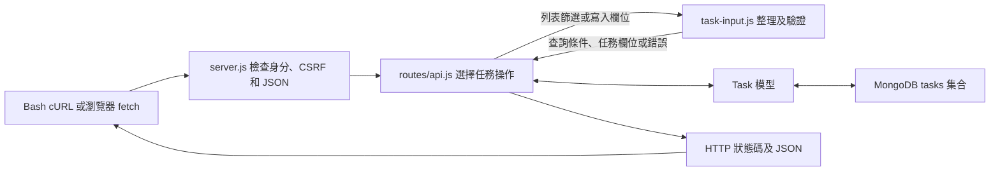

# 組員 5｜REST API、HTTP 狀態碼及 cURL

## 負責範圍

解釋用戶端如何把一次任務操作變成 HTTP 請求，Express 如何核對身分、驗證輸入和讀寫 MongoDB，以及怎樣從回應的狀態碼及 JSON 判斷結果。瀏覽器和 cURL 使用同一組端點。以下以 cURL 示範串起完整的任務生命週期。

## 程式碼地圖

| 位置 | 接收甚麼、交給誰 |
| --- | --- |
| [README 的 cURL 示範](../README.zh-Hant.md#curl-示範) | `api_call()` 收到預期狀態碼、方法、路徑及額外參數，讓 cURL 發送請求，並把伺服器回應留給 `jq` 核對 |
| [`public/forms.js` 的 `request()`](../public/forms.js#L41) | 網頁透過同源請求附帶 Cookie，按需要設定 CSRF 標頭及 JSON，再把回應交回列表或表單 |
| [`server.js` 的 API 掛載](../server.js#L79) | 用路徑前綴分派請求，為任務 API 排好登入檢查、CSRF 檢查和 JSON 解析的次序 |
| [`routes/auth.js` 的 Session 與驗證](../routes/auth.js#L29) | 帳戶端點和中介軟件使用 Passport 恢復身分，並核對 Session 的驗證碼 |
| [`routes/api.js` 的任務路由](../routes/api.js#L9) | 按 HTTP 方法和路徑選擇操作，將已驗證的條件或欄位交給 `Task` |
| [`task-input.js` 的驗證](../task-input.js#L14) · [`models/Task.js` 的模型](../models/Task.js#L6) | 前者把輸入整理為查詢條件或可儲存欄位並回傳錯誤，後者定義資料的驗證規則、預設值和索引 |

## 操作及請求流程



### 1. 登入前後使用不同的 Session

1. `GET /api/auth/csrf` 把驗證碼存入訪客 Session 並回傳 `200`。cURL 分開保存回應內的 `csrfToken` 和伺服器送來的 Cookie。 [取得驗證碼的路由](../routes/auth.js#L76) · [示範的訪客請求](../README.zh-Hant.md#L105)
2. `POST /api/auth/login` 同時提交訪客 Cookie、`X-CSRF-Token` 及 JSON 帳密。後端先檢查 JSON 類型和 CSRF，再解析 JSON 和驗證帳密。登入成功後，Passport 建立新的登入 Session，路由設定新的 CSRF 驗證碼。cURL 保存更新後的 Cookie。 [登入路由](../routes/auth.js#L114)
3. 用新 Cookie 再呼叫 `GET /api/auth/csrf`。之後每次任務請求帶上登入 Cookie，寫入任務及登出時再加上**登入後**取得的驗證碼。Cookie 讓伺服器找回 Session，驗證碼則用來核對寫入請求。 [示範取得新驗證碼的位置](../README.zh-Hant.md#L114) · [組員 1 的登入流程](./member-01-auth-session.md)

註冊和重設密碼同樣接受 JSON 和 Session 的 CSRF 驗證碼。README 的示範使用已自行註冊的測試帳戶，從登入開始。 [組員 2 的帳戶操作](./member-02-mongodb-accounts.md) · [帳戶 API 參考](./api-reference.md#帳戶與-session)

### 2. Express 依序檢查請求，再交給對應路由

```js
  app.use('/api/auth', auth.router);
  app.use('/api/tasks', auth.requireLogin, auth.requireCsrf, express.json({ limit: '16kb' }), apiRoutes);
```

這兩行把 `/api/auth` 和 `/api/tasks` 分別交給兩組路由。以 `PUT /api/tasks/:id` 為例，Passport 已在這段程式前嘗試恢復身分。接着執行 `requireLogin`、`requireCsrf` 和 JSON 解析，最後進入 `routes/api.js`。`GET` 讀取請求會略過 CSRF 檢查。路徑含 `:id` 時，`router.param('id')` 在任務操作前驗證 ID 格式。 [`server.js` 的 Passport 和路由設定](../server.js#L62) · [`requireCsrf()`](../routes/auth.js#L56) · [ID 檢查](../routes/api.js#L9)

### 3. 五個任務端點共用同一個登入者身分

| 請求 | 輸入與資料庫操作 | 成功回應及下一步 |
| --- | --- | --- |
| `POST /api/tasks` | `validateTask(req.body)` 整理 JSON。路由把 `req.user.id` 加為 `userId`，再呼叫 `Task.create()` | `201` 及新增後的任務 JSON。省略狀態時模型用 `In Progress`，用戶端從回應讀取 `_id`。[新增路由](../routes/api.js#L36) · [模型預設值](../models/Task.js#L14) |
| `GET /api/tasks` | `readTaskFilters(req.query)` 可將 `title` 和 `status` 合併到條件。以 `userId` 找自己的任務，按建立時間由新至舊排序 | `200` 及 JSON 陣列。沒有相符任務時回傳空陣列。[列表路由](../routes/api.js#L17) · [篩選驗證](../task-input.js#L70) |
| `GET /api/tasks/:id` | `Task.findOne()` 同時比對路徑的 `_id` 和登入者的 `userId` | `200` 及單筆任務物件，可用於預填編輯表單。[單筆路由](../routes/api.js#L29) · [編輯表單讀取資料](../public/forms.js#L284) |
| `PUT /api/tasks/:id` | `validateTask(req.body, { partial: true })` 只整理提交的可編輯欄位。`findOneAndUpdate()` 同時比對兩個 ID，以 `$set` 寫入欄位，並開啟模型驗證 | `200` 及更新後的任務。未提交的欄位保留原值。[更新路由](../routes/api.js#L47) · [組員 4 的驗證流程](./member-04-task-edit-delete-validation.md) |
| `DELETE /api/tasks/:id` | `Task.deleteOne()` 同時比對兩個 ID。回傳的 `deletedCount` 表示有沒有刪到資料 | `200` 及 `{"message":"Task deleted."}`。再次查詢同一 ID 預期是 `404`。[刪除路由](../routes/api.js#L64) |

單筆查詢的核心程式碼把兩個 ID 放在同一條查詢。用戶端指定任務 ID，伺服器從已登入的 Session 取得擁有者 ID。找不到符合兩項條件的任務時，路由回傳 `404`。修改和刪除也採用這個條件。 [`routes/api.js` 的單筆查詢](../routes/api.js#L30)

```js
  const task = await Task.findOne({ _id: req.params.id, userId: req.user.id }).lean();
  if (!task) return res.status(404).json({ error: 'Task not found.' });
  return res.json(task);
```

### 4. cURL 如何核對每一步

`api_call()` 用 `-b` 讀取 Cookie，再用 `-c` 保存伺服器回傳的 Cookie。`-o` 把回應主體寫入 `BODY`，`-w '%{http_code}'` 另外輸出狀態碼。函式逐次比對預期狀態，`jq -e` 則核對回應內容。登入帳密用 `jq -Rnc` 從輸入組成 JSON，Bash 把 JSON 經標準輸入交給 cURL。 [`api_call()` 和登入參數](../README.zh-Hant.md#L92)

| 示範段落 | 要核對的內容 |
| --- | --- |
| 新增及兩次讀取 | 新增回傳 `201`，取出 24 位十六進位 `_id`。在 `200` 的列表陣列和單筆回應各找到同一 ID |
| 修改 | 傳入新標題與 `Completed`。從 `200` 的回應確認 ID 一致、標題和狀態已改、描述保留 |
| 刪除及再查 | 刪除回傳 `200` 和確認訊息。再查同一 ID 的 `404` 是這一步的預期結果 |
| 登出 | 帶登入 Cookie 和驗證碼呼叫 `POST /api/auth/logout`。伺服器解除登入、銷毀 Session、清除 Cookie，回傳無主體的 `204` |

示範只用當次新增的 ID。Bash 區塊結束時，`trap` 清除暫存的 Cookie 和回應檔。若流程在刪除前停止，新任務仍可在測試帳戶的任務頁移除。 [完整 CRUD 指令](../README.zh-Hant.md#L118) · [登出路由](../routes/auth.js#L135)

## 逐步追蹤同一筆示範任務

### cURL 的參數、暫存檔和輸出

| 程式位置 | 傳入的值 | 下一步如何使用 |
| --- | --- | --- |
| 登入提示 | `read -r` 讀取原始文字，`IFS=` 保留首尾空白，`-s` 讓密碼輸入時不顯示 | `printf` 將兩行文字交給 `jq -Rnc` 編碼成 JSON。curl 的 `--data-binary @-` 從標準輸入接收該 JSON。[提示及登入輸入](../README.zh-Hant.md#L83) · [JSON 組裝](../README.zh-Hant.md#L105) |
| `api_call 201 POST /api/tasks …` | 前三個參數分別是預期狀態、方法、路徑。`shift 3` 留下 `-H` 和 `--data` 等 curl 參數 | `"$BASE$path"` 組成完整網址，`"$@"` 保留各參數邊界。回應主體與 HTTP 狀態分別進入 `BODY` 和 `status`。[請求函式](../README.zh-Hant.md#L92) |
| 訪客及登入後兩次取碼 | `COOKIE_JAR` 存放目前 Cookie，`BODY` 暫存最新回應 | `jq -er` 從主體提取 `csrfToken`，核對其為 64 位十六進位字串。登入後再取一次，會覆寫 Bash 的 `CSRF` 變數。[兩次取碼](../README.zh-Hant.md#L105) |
| `TASK_ID` | 新增回應的 `._id`，必須為 24 位十六進位字串 | 兩種讀取、PUT、DELETE 和刪除後的 GET 都使用當次取得的值。列表查詢以 `jq --arg id` 比對陣列內的任務。[擷取及比對 ID](../README.zh-Hant.md#L118) |

收到回應後，curl 會覆寫 `BODY`，所以在下一次請求前就要抽出稍後會用到的值。HTTP 狀態和 JSON 內容分開檢查。`api_call()` 先驗證狀態符合預期，`jq -e` 再確認指定的資料條件。Bash 的 `set -euo pipefail` 讓失敗指令、未定義變數或失敗的管道中止示範。登出回傳的 `204` 無主體，因此該步只核對狀態。 [Bash 設定](../README.zh-Hant.md#L78) · [狀態碼比較](../README.zh-Hant.md#L92) · [登出請求](../README.zh-Hant.md#L144)

### 對照新增和修改前後的資料

以下以 `64b000000000000000000101` 代表示範當次取得的任務 ID。新增送出 `{"title":"cURL CRUD demo","description":"Keep this description"}`，`validateTask()` 補上空的截止日期。路由將整理後的欄位和登入者 ID 交給 `Task.create()`，模型再套用預設狀態。以下節錄新增後的 JSON，省略擁有者及時間戳。 [新增指令](../README.zh-Hant.md#L118) · [驗證預設值](../task-input.js#L6) · [新增路由](../routes/api.js#L36) · [模型欄位](../models/Task.js#L6)

```json
{
  "_id": "64b000000000000000000101",
  "title": "cURL CRUD demo",
  "description": "Keep this description",
  "status": "In Progress",
  "dueDate": null
}
```

列表的 `200` 主體是陣列，示範從中選出相同 `_id`。單筆 GET 的 `200` 主體是物件，直接比對 `._id`。若有多筆任務同名，驗證仍以 ID 為準。 [列表和單筆驗證](../README.zh-Hant.md#L125)

修改時，Express 從 URL 取出 `req.params.id`，從 JSON 主體取得新標題和 `Completed`，從 Passport 恢復的帳戶取得 `req.user.id`。路由把兩個 ID 放入查詢條件，把已驗證的欄位放入 `$set`。修改後的 `200` 主體仍有原來的 `_id`、描述和空的截止日期。示範核對新標題、新狀態及保留下來的描述。 [局部更新路由](../routes/api.js#L47) · [PUT 指令及結果核對](../README.zh-Hant.md#L131)

```js
  const filter = { _id: req.params.id, userId: req.user.id };
  const updatedTask = await Task.findOneAndUpdate(filter, { $set: task }, {
    returnDocument: 'after', runValidators: true
  });
```

刪除時，兩個 ID 同時匹配才會令 `deletedCount` 為 `1`。成功的 JSON 只有確認訊息。接下來 `GET /api/tasks/:id` 查同一 ID，`api_call 404` 將 `404` 視為符合預期，後面的 `jq .` 顯示回應 `{"error":"Task not found."}`。這一步確認刪除生效，最後的登出才清除登入 Session。 [刪除路由](../routes/api.js#L64) · [刪除和再查指令](../README.zh-Hant.md#L138)

## 失敗時會發生甚麼

| 回應 | 在哪一層產生，如何讀取 |
| --- | --- |
| `401` · `403` | `requireLogin` 拒絕未登入的任務請求。登入路由也會為錯誤帳密回傳 `401`。驗證碼與目前 Session 不符時，`requireCsrf` 回傳 `403`。[登入及 CSRF 檢查](../routes/auth.js#L51) · [登入路由](../routes/auth.js#L114) |
| `400` | `router.param('id')` 檢查 ID 格式。任務欄位或篩選規則產生的 `400` 會附 `fields`。JSON 解析錯誤由 Express 的共用錯誤處理回應。[任務路由](../routes/api.js#L9) · [共用錯誤處理](../server.js#L83) |
| `404` | 找不到屬於登入者的指定任務會收到 `Task not found.`。重設時找不到帳戶會收到 `Username not found.`。網址沒有配對的路由時，共用處理回傳 `Page not found.`。[單筆查詢](../routes/api.js#L29) · [重設密碼](../routes/auth.js#L96) · [共用錯誤處理](../server.js#L83) |
| `409` · `415` | 註冊遇到重複名稱回傳 `409`。登入、註冊或重設以其他格式提交時，`requireJson` 回傳 `415`。[帳戶路由](../routes/auth.js#L67) |
| `413` | JSON 主體超過 16 KB 時，解析器回報大小限制，伺服器沿用該狀態碼回傳錯誤。[JSON 解析設定](../server.js#L81) · [共用錯誤處理](../server.js#L83) |
| `500` | 未預期的伺服器錯誤回傳通用訊息。伺服器紀錄錯誤名稱，API 回傳 JSON 的 `error` 欄位。[共用錯誤處理](../server.js#L83) |

瀏覽器的 `request()` 把 JSON 的 `error` 和 `fields` 交回畫面。需登入的操作收到 `401` 會返回登入頁，`403` 會清除前端暫存的驗證碼供下次請求重新取得，`204` 直接當成成功。cURL 示範則用每一步的預期狀態及內容判定是否繼續。 [`public/forms.js` 的回應處理](../public/forms.js#L41)

### 用第一個失敗的回應定位問題

| 手上的證據 | 怎樣順着程式碼檢查 |
| --- | --- |
| curl 顯示連線錯誤，未取得 HTTP 回應 | 先核對 `BASE` 和主機連接埠，再看服務是否已完成啟動。這時要檢查傳輸及服務狀態，排查點在請求到達 Express 之前。[示範伺服器網址](../README.zh-Hant.md#L78) · [啟動紀錄及連接埠](./member-06-ejs-css-docker.md#從主機的-8080-連到容器) |
| 登入請求回傳 `401` | 此次請求已通過帳戶路由的內容類型和驗證碼檢查。由登入路由檢查輸入規則，再看 Passport Local 的帳戶查詢及密碼比較。[登入錯誤分支](../routes/auth.js#L114) · [Passport Local](../routes/auth.js#L29) |
| 已登入的任務寫入請求回傳 `403` | 任務路由先執行 `requireLogin`，所以接下來查登入後的 Cookie 和 CSRF 是否來自同一 Session。此時任務資料仍未交到 `validateTask()`。[掛載次序](../server.js#L79) · [CSRF 檢查](../routes/auth.js#L56) |
| 自己的測試任務 PUT 回傳 `400` | 看 JSON 主體。有 `fields._form` 時檢查是否真的送了可編輯欄位。例如 `{}` 會收到 `Provide at least one editable task field.`。若主體只有 `Invalid request data.`，再看 JSON 本身能否解析。[驗證空更新](../task-input.js#L63) · [共用錯誤回應](../server.js#L83) |
| PUT 回傳 `200`，Bash 仍停在該步 | HTTP 比對已通過，接着檢查 `jq -e` 的四個條件，分別是 ID、標題、`Completed` 和原有描述。任何一項對不上都足以停止示範。[更新結果斷言](../README.zh-Hant.md#L131) |

## 示範與口頭講解

1. 啟動 TaskFlow，使用自己註冊的測試帳戶執行整段指令。指出訪客和登入後各取得一次驗證碼，再在輸出找出新增的 `_id`。 [README 的 cURL 示範](../README.zh-Hant.md#curl-示範)
2. 用同一 ID 對照兩種查詢、更新結果和刪除後的 `404`。指出哪兩個欄位有改，以及為甚麼描述仍保留。
3. 講解時能指出 `server.js` 的檢查次序、`routes/api.js` 的擁有者條件，以及為甚麼刪除成功有 JSON，登出成功卻直接回傳 `204`。

> cURL 先用訪客 Cookie 和驗證碼登入，再用新 Cookie 取得登入後的驗證碼。請求進到 Express 後，會先經過身分和寫入檢查。新增回傳 201 及任務 ID，我用這個 ID 做兩種查詢，再只修改標題和狀態。伺服器以任務 ID 和登入者 ID 找資料。刪除成功後，同一 ID 查不到而回傳 404，最後登出回傳 204。
