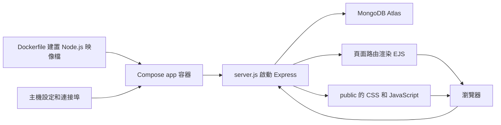

# 組員 6｜EJS、CSS 及 Docker

## 負責範圍

解釋應用程式怎樣由 Docker 建置和啟動，瀏覽器請求頁面時 Express 怎樣用 EJS 組成 HTML，以及 CSS 和 JavaScript 怎樣把 HTML 變成可操作的介面。以 **Tasks** 和 **Add task** 為例，可以沿着啟動指令、頁面路由、模板及瀏覽器資源追完整個流程。

## 程式碼地圖

| 位置 | 接收甚麼、交給誰 |
| --- | --- |
| [`Dockerfile`](../Dockerfile#L2) · [`package.json`](../package.json#L7) | Docker 用 Node.js 映像檔、套件鎖檔和原始碼建置應用程式。容器的 `npm start` 執行 `node server.js` |
| [`compose.yaml`](../compose.yaml#L1) · [`.env.example`](../.env.example#L1) | Compose 讀取主機的設定，把必要環境變數傳給 `app`，並把主機的連接埠映射到容器內的 `3000` |
| [`server.js` 的 `start()`](../server.js#L20) · [頁面路由](../server.js#L74) | 驗證設定、連接 Atlas、設定靜態檔案和 EJS，依網址執行頁面或 API 路由 |
| [`routes/tasks.js`](../routes/tasks.js#L9) · [`views/tasks.ejs`](../views/tasks.ejs#L1) · [`views/task-form.ejs`](../views/task-form.ejs#L1) | Express 根據網址產生模板所需的值。EJS 用這些值產生頁面的 HTML 和 `data-*` 屬性 |
| [`views/partials/header.ejs`](../views/partials/header.ejs#L1) · [`views/partials/footer.ejs`](../views/partials/footer.ejs#L1) | 共用 HTML 結構、頁首、跳到主要內容的連結和資源引用 |
| [`public/forms.js` 的 `initialize()`](../public/forms.js#L308) · [`public/styles.css`](../public/styles.css#L1) | JavaScript 接手表單與任務列表，按需要修改 HTML。CSS 按元素、類別、屬性和視窗寬度套用樣式 |

## 操作及請求流程



### 1. 從 Docker 建置到 Express 開始接收請求

1. 在專案根目錄執行 `docker compose up --build -d`。Compose 的 `build: .` 指向這個專案作為建置內容。Docker 以 `node:24-bookworm-slim` 為基礎，工作目錄設為 `/app`，先複製 `package.json` 和 `package-lock.json`，再用 `npm ci --omit=dev` 按鎖檔安裝執行套件。之後才複製原始碼，這樣只改原始碼時，可以重用套件安裝層。 [建置設定](../compose.yaml#L1) · [Dockerfile 安裝及複製步驟](../Dockerfile#L2)
2. `.dockerignore` 在複製之前排除本機 `node_modules`、`.git`、`.env`、`.env.*` 和測試輸出。Compose 在啟動時才把 `MONGODB_URI`、`SESSION_SECRET`、`COOKIE_SECURE` 和 `TRUST_PROXY` 傳給容器。前兩項是必要設定，後兩項預設為 `false`。主機 `PORT` 控制瀏覽器要連哪個埠，容器的 `PORT` 固定為 `3000`。 [建置排除清單](../.dockerignore#L1) · [Compose 傳入的設定](../compose.yaml#L8)
3. 容器以 `node` 使用者和 `NODE_ENV=production` 執行 `npm start`。進入 `server.js` 後，`start()` 檢查連線字串、64 位十六進位 Session 密鑰及連接埠。接着連上 MongoDB、等待 `User.init()` 完成唯一索引初始化，再設定 Express。最後在容器內以 `0.0.0.0:3000` 接收請求，主機則從 Compose 指定的 `127.0.0.1` 連入。 [容器啟動命令](../Dockerfile#L10) · [伺服器初始化](../server.js#L20) · [監聽位置](../server.js#L95)
4. 帳戶、任務和 Session 由 Atlas 儲存。停止或重建容器時，應用程式檔案由映像檔重建，資料仍在 Atlas。沿用資料庫和 Session 密鑰，可讓未過期且仍有效的登入繼續使用。Cookie 的 `secure` 由 `COOKIE_SECURE` 控制，`TRUST_PROXY=true` 時 Express 信任一層代理。 [MongoDB Session store](../server.js#L50) · [Cookie 設定](../routes/auth.js#L9) · [完整啟動指引](./setup.md)

以下是 Compose 的連接埠對應。第一段是主機位址，中間是可設定的主機埠，右邊是容器埠。Dockerfile 的 `EXPOSE 3000` 記錄容器使用的埠，這段 Compose 設定才建立主機映射。 [`compose.yaml` 的 `ports`](../compose.yaml#L5) · [`Dockerfile` 的 `EXPOSE`](../Dockerfile#L13)

```yaml
    ports:
      - "127.0.0.1:${PORT:-3000}:3000"
```

### 2. Express 如何把網址變成 HTML

`server.js` 將 `views/` 設為 EJS 模板目錄，將 `public/` 設為靜態檔案目錄，所以頁首可以用 `/styles.css` 和 `/forms.js` 直接引用資源。頁面請求經過相應路由後用 `res.render()` 回傳 HTML。 [EJS 和靜態資源設定](../server.js#L41)

| 網址 | 路由提供甚麼 | 模板如何使用 |
| --- | --- | --- |
| `/login`、`/register`、`/forgot-password` | `guestPage()` 選擇模板。已登入者會轉到 `/tasks` | 表單的 `action` 提供 API 路徑，`data-auth` 讓 `forms.js` 辨認要處理的帳戶操作。[訪客頁路由](../server.js#L69) · [登入表單](../views/login.ejs#L6) · [註冊表單](../views/register.ejs#L5) · [重設密碼表單](../views/forgot-password.ejs#L5) |
| `/tasks` | `requirePageLogin` 先檢查登入。頁面路由分析網址的 `view` 和 `title`，把 `completed`、`searchTitle` 及連結放入 `res.locals` | `tasks.ejs` 產生搜尋框、狀態卡、列表容器和 `#task-row` 模板。用 `data-view` 和 `data-search-title` 把畫面狀態交給 JavaScript。[任務頁掛載](../server.js#L79) · [共用頁面路由](../routes/tasks.js#L9) · [列表模板](../views/tasks.ejs#L1) |
| `/tasks/new`、`/tasks/:id/edit` | 兩條路由都渲染 `task-form`。新增把 `taskId` 設為空值。編輯先驗證 ID 格式，再把 ID 和頁面標題交給模板 | `task-form.ejs` 顯示正確標題和取消連結，並把 `taskId`、狀態和搜尋條件放入表單的 `data-*` 屬性。[表單路由](../routes/tasks.js#L35) · [共用表單模板](../views/task-form.ejs#L1) |
| 錯誤頁 | 傳入 HTTP 狀態和訊息 | `error.ejs` 顯示錯誤和返回連結。API 路徑的錯誤由共用處理回傳 JSON。[回應格式分派](../server.js#L13) · [錯誤模板](../views/error.ejs#L1) |

每頁透過 `<%- include(...) %>` 插入共用頁首和頁尾產生的 HTML。頁首的 `<%= title %>` 會轉義標題內容。頁首提供登出表單，並在 `<main>` 開頭放入共用的 `#request-error`。頁尾負責關閉主要區域及頁面標籤。 [共用頁首](../views/partials/header.ejs#L1) · [共用頁尾](../views/partials/footer.ejs#L1)

```html
  <title><%= title %> | TaskFlow</title>
  <link rel="stylesheet" href="/styles.css">
  <script src="/forms.js" defer></script>
```

### 3. JavaScript 更新 HTML，CSS 根據更新後的狀態顯示

`defer` 讓 `forms.js` 在 HTML 解析完後執行。`initialize()` 依畫面找到訪客表單、`#task-page` 或 `#task-form`，為它們加上操作事件。任務頁及任務表單會顯示帳戶導覽，並綁定登出按鈕。列表以 `GET /api/tasks` 取得 JSON，`buildTaskRow()` 複製 `#task-row` 並填入任務內容。編輯表單則用 `data-task-id` 查詢單筆任務，填入欄位後才啟用 `fieldset`。 [初始化入口](../public/forms.js#L308) · [列表渲染](../public/forms.js#L111) · [表單初始化](../public/forms.js#L284)

| 畫面表現 | 屬性或樣式由哪段程式控制 |
| --- | --- |
| 頁面寬度及小螢幕 | `.container` 限制內容寬度並保留兩側空間，頁首導覽和表單按鈕列可換行。面板、表單採用共用樣式，畫面寬度在 `480px` 或以下時縮小 `main` 及 `.panel` 的內距。[容器與頁首](../public/styles.css#L23) · [共用面板](../public/styles.css#L136) · [小螢幕規則](../public/styles.css#L357) |
| 正在查看的任務狀態 | EJS 按 `completed` 設定目前卡片的 `aria-current="page"`。CSS 顯示選中的卡片，JavaScript 從 API 結果填入兩張卡的數字。[狀態卡模板](../views/tasks.ejs#L18) · [選中卡樣式](../public/styles.css#L154) · [計數更新](../public/forms.js#L157) |
| 已完成、逾期及選單 | `buildTaskRow()` 切換勾選圖示的 `.is-checked` 類別，並按日期及狀態設定 `.overdue` 的 `hidden` 屬性。CSS 控制勾選和逾期標籤的外觀。選單的 `<details>` 提供開關，JavaScript 在點擊選單外或按 Escape 時關閉，按 Escape 時把焦點交回 `summary`。[建立任務列](../public/forms.js#L111) · [選單事件](../public/forms.js#L329) · [任務列樣式](../public/styles.css#L285) |
| 錯誤提示與鍵盤操作 | `showMessage()` 切換 `hidden`，`showFieldErrors()` 設定 `aria-invalid` 並填入 `aria-describedby` 指向的訊息。CSS 的 `[hidden]` 隱藏元素，`:focus-visible` 顯示鍵盤焦點，頁首的 **Skip to content** 取得焦點時會顯示。[訊息及欄位錯誤](../public/forms.js#L9) · [欄位輔助屬性](../public/forms.js#L275) · [隱藏規則](../public/styles.css#L150) · [焦點及錯誤樣式](../public/styles.css#L233) |

列表的篩選、計數和狀態切換可沿組員 3 的流程繼續閱讀。共用表單如何驗證及儲存，可接到組員 4 的流程。 [列表及狀態切換](./member-03-task-list-status.md) · [編輯、刪除及驗證](./member-04-task-edit-delete-validation.md)

## 用一條網址追蹤部署、模板及畫面

### 從主機的 8080 連到容器

假設測試環境的主機設定為 `PORT=8080`，Compose 將連接埠映射展開成 `127.0.0.1:8080:3000`。在同一時間，`environment` 將 `PORT=3000` 傳給容器。瀏覽器開啟 `http://127.0.0.1:8080`，請求由 Docker 轉到容器，再由 Express 的 `app.listen(port, '0.0.0.0', …)` 接收。啟動紀錄仍顯示 `TaskFlow is listening on port 3000.`，因為它輸出的是 Node.js 程序的監聽埠。 [Compose 的映射和環境設定](../compose.yaml#L4) · [Express 讀取連接埠](../server.js#L25) · [啟動紀錄](../server.js#L95)

| 檢查位置 | 這個例子的預期值 | 能確認甚麼 |
| --- | --- | --- |
| 主機設定 | `PORT=8080` | Compose 映射左邊的主機埠由此取得 |
| `docker compose port app 3000` | `127.0.0.1:8080` | 查看已運行容器的主機埠 |
| `docker compose logs app` | `TaskFlow is listening on port 3000.` | Node.js 已完成設定、資料庫連線和索引初始化，並在容器內接受請求 |

建置階段讀取 `Dockerfile` 和套件鎖檔。啟動階段讀取資料庫連線字串和 Session 密鑰。改變 CSS 或 EJS 後，`docker compose up --build -d` 會按最新的專案檔案重建並啟動服務。程式變更後可在瀏覽器核對產生的 HTML 及下載的樣式。 [安裝與複製次序](../Dockerfile#L4) · [執行設定](../compose.yaml#L8) · [建置和啟動指令](./setup.md#啟動及停止服務)

### 同一個搜尋條件如何由 Express 傳到表單

登入後開啟 `/tasks?view=completed&title=Launch+Plan`。網址解碼後，`req.query.view` 為 `completed`，`req.query.title` 為 `Launch Plan`。以下片段是伺服器把這些值交給 EJS 的位置。 [產生頁面變數](../routes/tasks.js#L9) · [渲染 Tasks](../routes/tasks.js#L33)

```js
  Object.assign(res.locals, {
    completed,
    searchTitle,
    viewQuery: listUrl(completed).slice('/tasks'.length),
    inProgressUrl: listUrl(false),
    completedUrl: listUrl(true),
    returnUrl: listUrl(completed)
  });
```

| 程式層 | 這個例子傳遞的值 | 可以在哪裏觀察 |
| --- | --- | --- |
| `routes/tasks.js` | `completed = true`。 `searchTitle = 'Launch Plan'`。`viewQuery` 是 `?view=completed&title=Launch+Plan` | 用這幾個值對照共用路由，留意 `listUrl(false)` 只保留標題條件。[產生 URL 和 locals](../routes/tasks.js#L14) |
| `tasks.ejs` | `#task-page` 的 `data-view` 為 `completed`，`data-search-title` 為 `Launch Plan`。**Completed** 卡帶 `aria-current="page"` | 在頁面的 **Elements** 查看這些屬性。原始 HTML 裏，連結的查詢分隔符會經 EJS 轉義為 `&amp;`，瀏覽器按 `&` 處理。[列表模板](../views/tasks.ejs#L2) · [狀態卡和連結](../views/tasks.ejs#L16) |
| `public/forms.js` | 從 `page.dataset.searchTitle` 取值，呼叫 `GET /api/tasks?title=Launch+Plan`，用 `page.dataset.view` 決定要顯示的任務組別 | 在 **Network** 找到獨立的 JSON 請求。再回 **Elements** 核對 `.task-list` 中由 JavaScript 插入的任務列。[取資料及更新列表](../public/forms.js#L143) |
| **Add task** 頁 | 開啟 `/tasks/new?view=completed&title=Launch+Plan`。共用路由重新產生相同條件。表單的 `data-task-id` 為空，取消連結使用 `returnUrl` | 在 **Elements** 看 `#task-form` 與 **Cancel**。儲存後，`initializeTaskForm()` 用表單的 `dataset` 重建回列表的 URL。[表單路由](../routes/tasks.js#L35) · [表單屬性](../views/task-form.ejs#L1) · [儲存後導頁](../public/forms.js#L294) |

**View Source** 顯示 Express 送回的 HTML。**Elements** 則顯示瀏覽器目前的 DOM。單看 HTML 時會見到空的 `.task-list` 和 `#task-row` 模板。等 API 回應後，`buildTaskRow()` 才會填入標題、屬性和按鈕標籤，再把實際任務列加入列表。這兩個畫面可以用來解釋同一個任務列從哪裏出現。 [任務模板及列表容器](../views/tasks.ejs#L28) · [複製和填入資料](../public/forms.js#L111) · [插入任務列](../public/forms.js#L157)

### 讀懂樣式規則和畫面狀態

| 在畫面驗證的細節 | 程式碼如何一起決定結果 |
| --- | --- |
| 將視窗寬度由 `481px` 改為 `480px` | `@media (max-width: 480px)` 開始生效，`main` 的直向內距改為 `1.25rem`，一般 `.panel` 改為 `1rem`。列表元素同時有 `task-list` 與 `panel`，較具體的 `.task-list.panel` 讓它保持 `padding: 0`。[預設內距](../public/styles.css#L21) · [一般面板](../public/styles.css#L136) · [列表面板](../public/styles.css#L267) · [窄螢幕規則](../public/styles.css#L357) |
| 看到搜尋欄與 **Add task** 並排 | `.page-heading` 建立 Flex 排列。`.task-search` 可收窄，其 `min-width: 0` 允許它在較窄空間收縮。`.page-heading > .button` 使用 `flex-shrink: 0` 和 `white-space: nowrap` 保留按鈕所需位置。[搜尋及新增按鈕樣式](../public/styles.css#L58) |
| 看見一個已完成任務的勾號 | `buildTaskRow()` 讀取 JSON 的 `status`，對勾選圖示加入 `is-checked`、填入 `✓`，並給按鈕 `Reopen task: 任務標題` 的輔助標籤。`.task-check.is-checked` 再為圖示套用已完成樣式。[任務列狀態](../public/forms.js#L111) · [勾號樣式](../public/styles.css#L301) |
| 欄位變紅，訊息出現在欄位下方 | `showFieldErrors()` 以輸入欄 `name` 取回 API 的欄位訊息，以 `aria-describedby` 定位錯誤段落，再設定 `aria-invalid="true"`。CSS 依照該屬性改變邊框，並以 `.field-error` 設定錯誤文字樣式。[模板的欄位與訊息連結](../views/task-form.ejs#L6) · [顯示欄位錯誤](../public/forms.js#L275) · [樣式規則](../public/styles.css#L247) |

## 失敗時會發生甚麼

| 情況 | 從哪裏開始檢查 |
| --- | --- |
| Compose 在容器啟動前指出環境變數缺失 | 看 `compose.yaml` 的必要變數，並核對測試環境的 `.env` 設定。[環境變數](../compose.yaml#L8) |
| 容器已啟動，應用程式沒有開始監聽 | 用 `docker compose logs app` 看是否為設定、Atlas 連線、索引初始化或監聽錯誤。[啟動檢查](../server.js#L20) · [監聽及啟動錯誤](../server.js#L95) |
| 瀏覽器看到頁面外框，列表或表單操作出錯 | 在瀏覽器 Network 面板查看 `/forms.js` 和 API 請求。JavaScript 關閉時會顯示 `noscript` 訊息。API 或初始化出錯時，JavaScript 可透過 `#request-error` 顯示錯誤。[共用提示區](../views/partials/header.ejs#L22) · [初始化錯誤處理](../public/forms.js#L343) |

可用三個問題定位問題。「瀏覽器收到正確 HTML 嗎？」先看 Document 的回應及 `data-*` 值。「HTML 正確，列表有資料嗎？」再看 `/forms.js`、**Console** 及任務 API 的 JSON。「DOM 有正確類別，外觀有套用嗎？」最後在 **Styles** 或 **Computed** 核對 CSS 選擇器、屬性和視窗寬度。 [伺服器模板與靜態資源](../server.js#L41) · [列表載入](../public/forms.js#L143) · [小螢幕規則](../public/styles.css#L357)

## 示範與口頭講解

1. 按啟動指引運行 Docker Compose。用 `docker compose logs app` 找到 `TaskFlow is listening on port 3000.`，解釋主機埠和容器內埠如何對應。 [Docker 與 Atlas 啟動指引](./setup.md)
2. 用自己的測試帳戶登入，開啟 **Tasks** 和 **Add task**。在瀏覽器 Network 面板指出 HTML、`styles.css`、`forms.js` 和 Tasks 頁的 `GET /api/tasks`。說明哪部分由 EJS 產生，哪部分由 API 資料更新。
3. 將視窗調到約 `375px`。用 Tab 找到焦點外框，操作搜尋框和按鈕。開啟任務選單後按 Escape，確認選單關閉，焦點回到該選單。

> Dockerfile 安裝套件並建好映像檔。Compose 把 Atlas 設定傳給容器，並把主機埠對應到容器的 3000。Express 接到網頁請求後，用 EJS 組成 HTML，共用頁首載入 CSS 和 JavaScript。任務資料會在瀏覽器呼叫 API 後填入列表。CSS 根據類別、屬性和視窗寬度改變介面，所以我可以示範小螢幕、鍵盤焦點和不同任務狀態。
